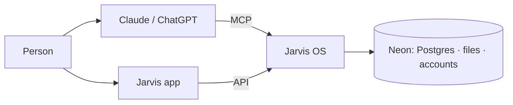

# Jarvis OS

The memory, the time and the method a model needs to hold a person's life — a SaaS. A person
creates her account, then Claude, ChatGPT (through MCP) or the Jarvis app (through the API) save
what she says, link it, compute from it and remind her on time.

> Product documents are in French in [`docs/product/`](docs/product/); everything else is in
> English. Successor of the first Jarvis (decision [0001](docs/decisions/0001-jarvis-os-succeeds-jarvis.md)).



## Read first

1. [`.specify/memory/constitution.md`](.specify/memory/constitution.md) — the rules.
2. [`docs/product/vision.md`](docs/product/vision.md) — what we build and why.
3. [`docs/ARCHITECTURE.md`](docs/ARCHITECTURE.md), [`docs/ROADMAP.md`](docs/ROADMAP.md),
   [`docs/decisions/`](docs/decisions/).

## Start

```bash
pnpm install
pnpm provision    # once: the Neon project, its branches, role and storage → .env
pnpm db:migrate   # the dev branch
pnpm test         # on the Neon test branch
```

`pnpm provision` reads `NEON_API_KEY` from `../.secrets/atelier-admin.env` (or the environment)
and writes `.env`, never committed. Behind an antivirus that inspects HTTPS, set
`NODE_EXTRA_CA_CERTS` to its root certificate.

## Branches

```
main       production — the human gesture only
dev        integration — green CI required before merging
NNN-slug   one Spec Kit feature, branched from dev
```
