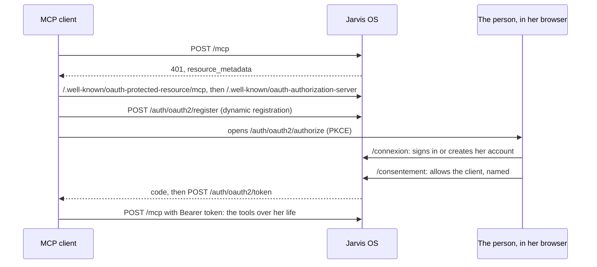

# @jarvis-os/api

The doors of Jarvis OS over the core: accounts and OAuth (`/auth`), the REST API (`/api`) and the
MCP server (`/mcp`). A Hono server; the routes parse, call `@jarvis-os/core` and answer.

```mermaid
flowchart LR
  C[Client: app, tests] -->|Bearer token| API[/api/]
  M[MCP client: Claude, ChatGPT] -->|OAuth access token| MCP[/mcp/]
  C -->|sign up, sign in| AUTH[/auth — Better Auth, OAuth server/]
  M -->|register, sign in, consent| AUTH
  API -->|asPerson| CORE[@jarvis-os/core]
  MCP -->|asPerson| CORE
  CORE --> PG[(Neon Postgres, RLS)]
  API -->|files| S3[(Neon Object Storage)]
```

## Run

```bash
pnpm db:migrate             # core and accounts tables on the dev branch
pnpm --filter @jarvis-os/api dev   # http://localhost:3700, dev branch
pnpm --filter @jarvis-os/api test  # Neon test branch and its storage
```

## Accounts

`POST /auth/sign-up/email` `{ email, name, password }` makes the account and its space and signs in;
`POST /auth/sign-in/email` signs in. Both answer with a `set-auth-token` header: send it as
`Authorization: Bearer <token>` (or keep the session cookie).

## Routes

| Method | Path                                                         | Core function                        |
| ------ | ------------------------------------------------------------ | ------------------------------------ |
| GET    | `/api/me`                                                    | her account, her own space, all hers |
| GET    | `/api/kinds`                                                 | `kinds`                              |
| GET    | `/api/entries?text&kind&from&to&archived&limit`              | `find`                               |
| GET    | `/api/entries/:id`                                           | `get`                                |
| POST   | `/api/save`                                                  | `save`                               |
| POST   | `/api/entries/:id/archive`                                   | `archive`                            |
| POST   | `/api/query` `{ sql }`                                       | `query`                              |
| GET    | `/api/history?target&limit`                                  | `history`                            |
| POST   | `/api/undo` `{ journalId }`                                  | `undo`                               |
| POST   | `/api/files` (multipart `file`, `title?`, `data?`, `links?`) | `addFile`                            |
| GET    | `/api/files/:id`                                             | the file's bytes                     |
| GET    | `/api/files/:id/link?seconds`                                | a link that opens it without a token |

Every route acts in the space named by `?space=` (an id or a name) or the `x-jarvis-space` header,
else in her own; `/api/query` reads all her spaces unless one is named (spec 004).

| Method | Path                                       | What it does                                         |
| ------ | ------------------------------------------ | ---------------------------------------------------- |
| GET    | `/api/spaces`                              | her spaces, with who belongs                         |
| POST   | `/api/spaces` `{ name }`                   | a shared space she owns                              |
| PATCH  | `/api/spaces/:id` `{ name }`               | rename (owner)                                       |
| POST   | `/api/spaces/:id/invitations` `{ email }`  | an invitation link, 14 days (owner)                  |
| GET    | `/api/spaces/:id/invitations`              | the invitations and their state                      |
| DELETE | `/api/spaces/:id/invitations/:invitation`  | withdraw (owner)                                     |
| DELETE | `/api/spaces/:id/members/:person`          | `me` to leave; another member, for an owner, removes |
| POST   | `/api/invitations/accept` `{ token }`      | join, signed in with the invited address             |
| GET    | `/api/clients/:client/spaces`              | the spaces an OAuth client may reach for her         |
| PUT    | `/api/clients/:client/spaces` `{ spaces }` | set them                                             |

The invitation page, `/invitation#<secret>`, reads the secret from its fragment (never sent to a
server), shows the space, has her sign in or create her account, then accepts.

Errors answer `{ error }` with 400 (what to fix), 401 (sign in), 404 (not in her space) or 500.
An `x-jarvis-client` header names the client in the journal.

## MCP

`/mcp` is a stateless Streamable HTTP server. Each request carries an OAuth access token; the
server is built for that token's person and the spaces she allowed that client at consent (her
own only, for a client connected before spec 004), with Jarvis's instructions, the charter and the
routines of each of those spaces, and the tools. Every tool takes an optional `space` (a name or an
id); `query` reads all of them, `my_entries.space` naming each row's.

| Tool           | Core function                                                        |
| -------------- | -------------------------------------------------------------------- |
| `kinds`        | `kinds`                                                              |
| `find`         | `find`                                                               |
| `get`          | `get`                                                                |
| `save`         | `save`                                                               |
| `archive`      | `archive`                                                            |
| `query`        | `query`                                                              |
| `history`      | `history`                                                            |
| `undo`         | `undo`                                                               |
| `add_file`     | `addFile`                                                            |
| `file_link`    | a link that opens a file without a token                             |
| `routine`      | one of her routines, or a base one (`src/routines/`)                 |
| `spaces`       | the spaces this connection reaches, with who belongs                 |
| `create_space` | a shared space she owns, reached by this client                      |
| `invite`       | an invitation link into a shared space she owns                      |
| `dashboard`    | widgets (query + chart) recomputed now; view `ui://jarvis/dashboard` |
| `show_entry`   | one entry as a card, undoable; view `ui://jarvis/entry`              |
| `upload_link`  | a link where files go straight in; view `ui://jarvis/upload`         |

### Views (MCP Apps, spec 005)

`src/views/` holds Jarvis's views: plain HTML in the Kete brand (light, dark, phone width) with a
small bridge speaking the MCP Apps protocol (`ui/initialize`, the tool's result, the host's theme
and language, `tools/call`). Hosts that render MCP Apps (Claude, ChatGPT…) show them; every tool
still answers in words for the others. Files go to `POST /upload/:token` — a token signed with the
server's secret, 30 minutes, one person, one space — never through the model; `GET` on the same
link is a page with the drop zone.

A client finds everything from the 401 alone:



### Connect Claude Code to the local server

```bash
pnpm --filter @jarvis-os/api dev
```

```bash
claude mcp add --transport http jarvis-dev http://localhost:3700/mcp
```

Then, in Claude Code, `/mcp` → `jarvis-dev` → **Authenticate**: the browser opens the sign-in page
(on the Neon `dev` branch), then the consent page; Claude Code then lists the tools.
