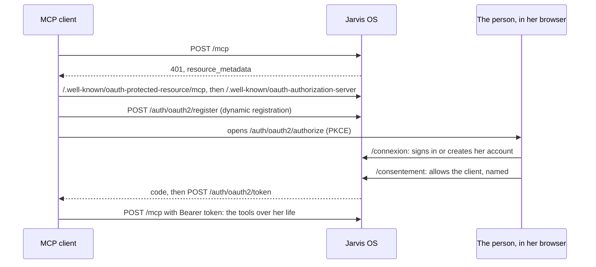
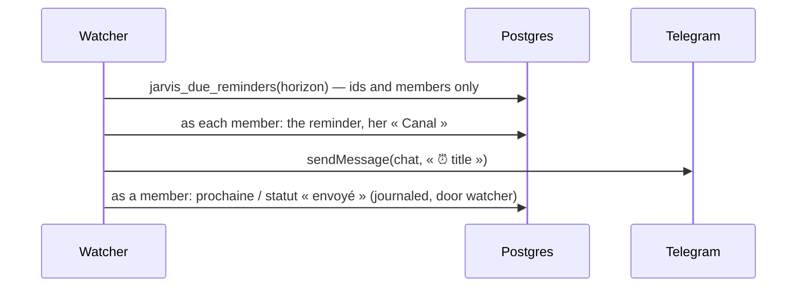

# @jarvis-os/api

The doors of Jarvis OS over the core: accounts and OAuth (`/auth`), the REST API (`/api`) and the
MCP server (`/mcp`). A Hono server; the routes parse, call `@jarvis-os/core` and answer.

```mermaid
flowchart LR
  C[Client: app, tests] -->|Bearer token| API[/api/]
  M[MCP client: Claude, ChatGPT] -->|OAuth access token| MCP[/mcp/]
  C -->|sign up, sign in| AUTH[/auth — Better Auth, OAuth server/]
  M -->|register, sign in, consent| AUTH
  API -->|asPerson| CORE[@jarvis-os/core]
  MCP -->|asPerson| CORE
  CORE --> PG[(Neon Postgres, RLS)]
  API -->|files| S3[(Neon Object Storage)]
```

## Run

```bash
pnpm db:migrate             # core and accounts tables on the dev branch
pnpm --filter @jarvis-os/api dev   # http://localhost:3700, dev branch
pnpm --filter @jarvis-os/api test  # Neon test branch and its storage
pnpm serve                         # API + watcher + tunnel at https://<JARVIS_TUNNEL_DOMAIN>
```

`pnpm serve` keeps one address for the clients: the API on the `dev` branch, the watcher, and an
ngrok tunnel on the fixed domain of `.env`; each restarts when it stops, and closing it stops them
all. Run it again to take a change.

## Accounts

`POST /auth/sign-up/email` `{ email, name, password }` makes the account and its space and signs in;
`POST /auth/sign-in/email` signs in. Both answer with a `set-auth-token` header: send it as
`Authorization: Bearer <token>` (or keep the session cookie).

## Routes

| Method | Path                                                         | Core function                                                     |
| ------ | ------------------------------------------------------------ | ----------------------------------------------------------------- |
| GET    | `/api/me`                                                    | her account, her own space, all hers                              |
| GET    | `/api/kinds`                                                 | `kinds`                                                           |
| GET    | `/api/entries?text&kind&from&to&archived&limit`              | `find`                                                            |
| GET    | `/api/entries/:id`                                           | `get`                                                             |
| POST   | `/api/save`                                                  | `save`                                                            |
| POST   | `/api/entries/:id/archive`                                   | `archive`                                                         |
| POST   | `/api/query` `{ sql }`                                       | `query`                                                           |
| GET    | `/api/history?target&limit`                                  | `history`                                                         |
| POST   | `/api/undo` `{ journalId }`                                  | `undo`                                                            |
| POST   | `/api/files` (multipart `file`, `title?`, `data?`, `links?`) | `addFile`                                                         |
| GET    | `/api/files/:id`                                             | the file's bytes                                                  |
| GET    | `/api/files/:id/link?seconds`                                | a link that opens it without a token                              |
| GET    | `/api/agenda?from&to`                                        | `agenda` over all her spaces (spec 011), this week by default     |
| POST   | `/api/agenda/address`                                        | a new private address for her phone's calendar; the old one stops |

Every route acts in the space named by `?space=` (an id or a name) or the `x-jarvis-space` header,
else in her own; `/api/query` reads all her spaces unless one is named (spec 004).

| Method | Path                                       | What it does                                         |
| ------ | ------------------------------------------ | ---------------------------------------------------- |
| GET    | `/api/spaces`                              | her spaces, with who belongs                         |
| POST   | `/api/spaces` `{ name }`                   | a shared space she owns                              |
| PATCH  | `/api/spaces/:id` `{ name }`               | rename (owner)                                       |
| POST   | `/api/spaces/:id/invitations` `{ email }`  | an invitation link, 14 days (owner)                  |
| GET    | `/api/spaces/:id/invitations`              | the invitations and their state                      |
| DELETE | `/api/spaces/:id/invitations/:invitation`  | withdraw (owner)                                     |
| DELETE | `/api/spaces/:id/members/:person`          | `me` to leave; another member, for an owner, removes |
| POST   | `/api/invitations/accept` `{ token }`      | join, signed in with the invited address             |
| GET    | `/api/clients/:client/spaces`              | the spaces an OAuth client may reach for her         |
| PUT    | `/api/clients/:client/spaces` `{ spaces }` | set them                                             |

| Method | Path                                                      | What it does                                                    |
| ------ | --------------------------------------------------------- | --------------------------------------------------------------- |
| GET    | `/api/export`                                             | the space as a zip of Markdown and her files (spec 007)         |
| POST   | `/api/import` `{ docs: [{ path, text }], kinds?, name? }` | a Markdown folder into the space; the report and its journal id |

The invitation page, `/invitation#<secret>`, reads the secret from its fragment (never sent to a
server), shows the space, has her sign in or create her account, then accepts.

Errors answer `{ error }` with 400 (what to fix), 401 (sign in), 404 (not in her space) or 500.
An `x-jarvis-client` header names the client in the journal.

## The platform (spec 009)

`/` leads to `/app`, her web account, behind her session (else `/connexion`): one page, no build,
in the Kete brand, drawing each part from `/api`.

| Part             | What she does there                                                  | Through                                   |
| ---------------- | -------------------------------------------------------------------- | ----------------------------------------- |
| Accueil          | counts, the next seven days, the latest changes                      | `GET /api/overview`                       |
| Ma vie           | her kinds, entries, search; an entry with origins, links, text, undo | `/api/kinds`, `/api/entries`, `/api/undo` |
| Documents        | her long texts, read, printed, downloaded                            | `/app/frame/document/:id`                 |
| Tableaux de bord | her saved dashboards, recomputed                                     | `/app/frame/dashboard/:id`                |
| Rappels          | each reminder, its next time; her channel                            | `/api/entries?kind=Rappel`                |
| Journal          | every change, undoable                                               | `/api/history`, `/api/undo`               |
| Espaces          | members, rename, invite, withdraw, leave, create                     | `/api/spaces…`                            |
| Connexions       | the clients she allowed, their spaces, disconnecting                 | `/api/connections`, `/api/clients/…`      |
| Mes données      | her space as a zip of Markdown; a Markdown folder brought in         | `/api/export`, `/api/import`              |

| Method | Path                       | What it does                                                   |
| ------ | -------------------------- | -------------------------------------------------------------- |
| GET    | `/api/overview`            | counts per space, the next seven days, changes, recent lines   |
| GET    | `/api/documents/:id`       | a document as HTML, its outline and reading link               |
| POST   | `/api/dashboard`           | a saved dashboard (`id`) or `widgets`, computed now            |
| GET    | `/api/connections`         | the clients she consented to, since when, last used, spaces    |
| DELETE | `/api/connections/:client` | disconnect: consent removed, tokens revoked, refused by `/mcp` |

## MCP

`/mcp` is a stateless Streamable HTTP server. Each request carries an OAuth access token; the
server is built for that token's person and the spaces she allowed that client at consent (her
own only, for a client connected before spec 004), with Jarvis's instructions, the charter and the
routines of each of those spaces, and the tools. Every tool takes an optional `space` (a name or an
id); `query` reads all of them, `my_entries.space` naming each row's.

| Tool             | Core function                                                        |
| ---------------- | -------------------------------------------------------------------- |
| `kinds`          | `kinds`                                                              |
| `find`           | `find`                                                               |
| `get`            | `get`                                                                |
| `save`           | `save`                                                               |
| `archive`        | `archive`                                                            |
| `query`          | `query`                                                              |
| `history`        | `history`                                                            |
| `undo`           | `undo`                                                               |
| `add_file`       | `addFile`                                                            |
| `file_link`      | a link that opens a file without a token                             |
| `routine`        | one of her routines, or a base one (`src/routines/`)                 |
| `spaces`         | the spaces this connection reaches, with who belongs                 |
| `create_space`   | a shared space she owns, reached by this client                      |
| `invite`         | an invitation link into a shared space she owns                      |
| `dashboard`      | widgets (query + chart) recomputed now; view `ui://jarvis/dashboard` |
| `show_entry`     | one entry as a card, undoable; view `ui://jarvis/entry`              |
| `upload_link`    | a link where files go straight in; view `ui://jarvis/upload`         |
| `write_document` | a new document: Markdown in `texte`, a kind in her words (spec 008)  |
| `edit_document`  | one change by section (append, replace, insert after) or passage     |
| `read_document`  | outline, then text or sections; view `ui://jarvis/document`          |
| `agenda`         | her calendar for a window, every kind with a time field (spec 011)   |

A document's reading link, `/document/:token` (a day, one document), is a page to read and print as
PDF; `?format=md` gives its Markdown file.

Her calendar for her phone, `/agenda/:key.ics` (spec 011), is iCalendar that Google Calendar or an
iPhone subscribes to: a month back, eleven ahead; a repetition her phone can repeat goes once, as
an RRULE. The key is random; only its sha-256 is kept. A new address answers, the old one is gone.

### Views (MCP Apps, spec 005)

`src/views/` holds Jarvis's views: plain HTML in the Kete brand (light, dark, phone width) with a
small bridge speaking the MCP Apps protocol (`ui/initialize`, the tool's result, the host's theme
and language, `tools/call`). Hosts that render MCP Apps (Claude, ChatGPT…) show them; every tool
still answers in words for the others. Files go to `POST /upload/:token` — a token signed with the
server's secret, 30 minutes, one person, one space — never through the model; `GET` on the same
link is a page with the drop zone.

A client finds everything from the 401 alone:



### Connect Claude Code to the local server

```bash
pnpm --filter @jarvis-os/api dev
```

```bash
claude mcp add --transport http jarvis-dev http://localhost:3700/mcp
```

Then, in Claude Code, `/mcp` → `jarvis-dev` → **Authenticate**: the browser opens the sign-in page
(on the Neon `dev` branch), then the consent page; Claude Code then lists the tools.

## Markdown from the command line

The author's tool for a folder on his disk (spec 007): it acts as the account named, on the branch
named (`dev` by default), under row-level security.

```bash
pnpm --filter @jarvis-os/api markdown import ../lifeos_docs --email <address> --kinds kinds.json --skip _archive --dry
```

- Under git, only tracked files are read; hidden folders, `node_modules` and code projects
  (`package.json`, `pyproject.toml`…) are left out, and each `--skip` path too.
- `--kinds` maps folder names (and kinds) to the kinds she uses: `{ "resolutions": "Résolution" }`.
- `--dry` counts the kinds without writing; `--space` names another space than her own.
- `--include .claude/skills` reads a hidden folder too: each `SKILL.md` (its `name`, its
  `description`) becomes a « Routine » when `--kinds` maps `skills` to it; a file is named by its
  path to become the charter (`{ "SYSTEME.md": "Charte" }`).
- `markdown export <folder> --email <address>` writes the space back as files.

## The watcher (spec 006)

A pass each minute (`pnpm --filter @jarvis-os/api watcher`, or within `pnpm serve`): the reminders
due (« Rappel » with `quand`, or `repete` in five fields on the clock of `fuseau`) are told to each
person of their space through her « Canal » — Telegram, by the bot of `JARVIS_TELEGRAM_BOT_TOKEN`.
`watcher link --email <address>` makes the chat of `JARVIS_TELEGRAM_CHAT_ID` her channel.


