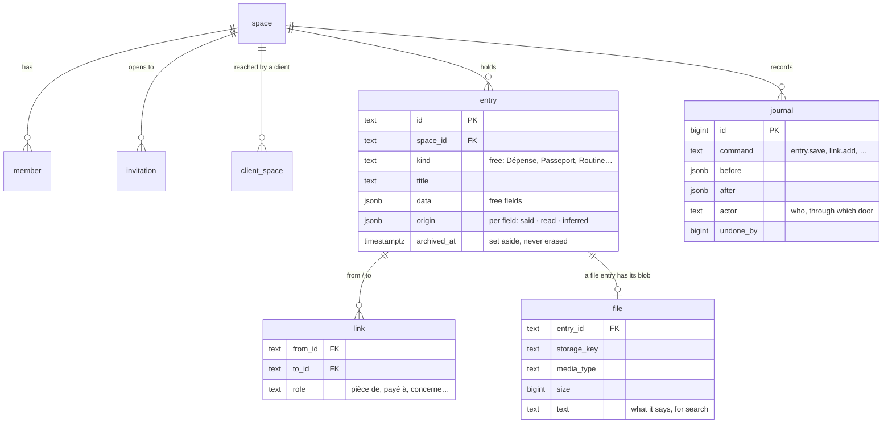
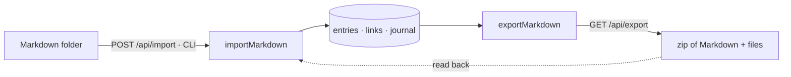
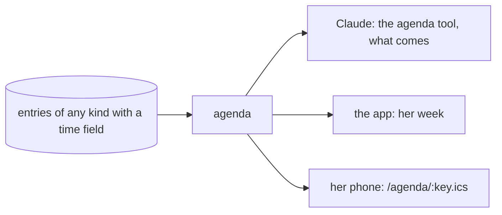
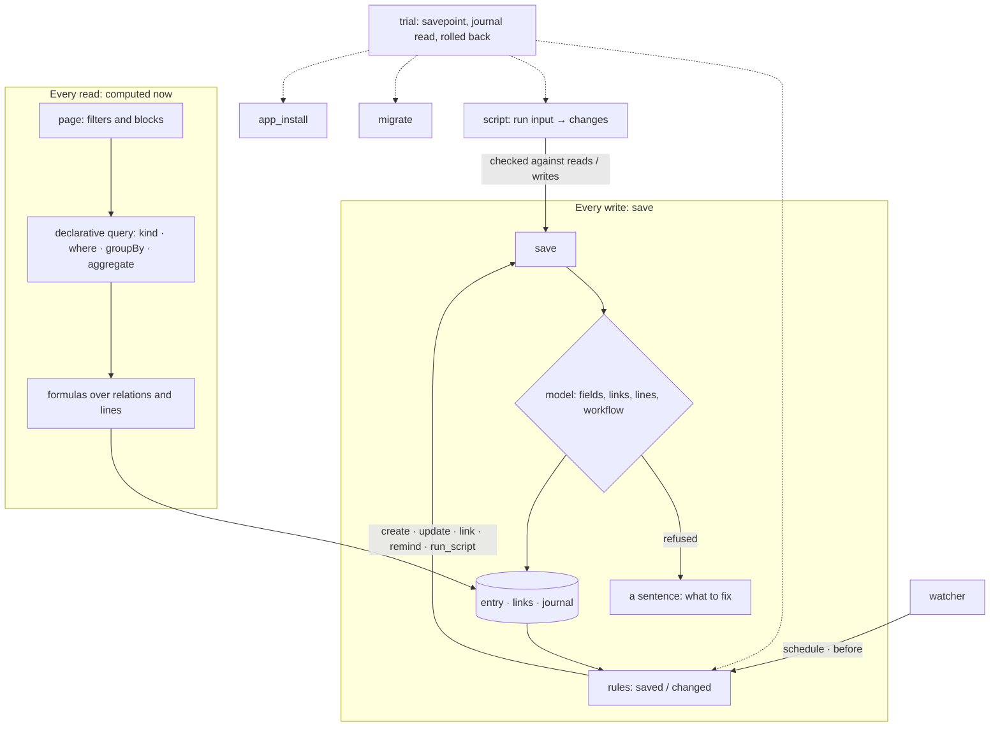
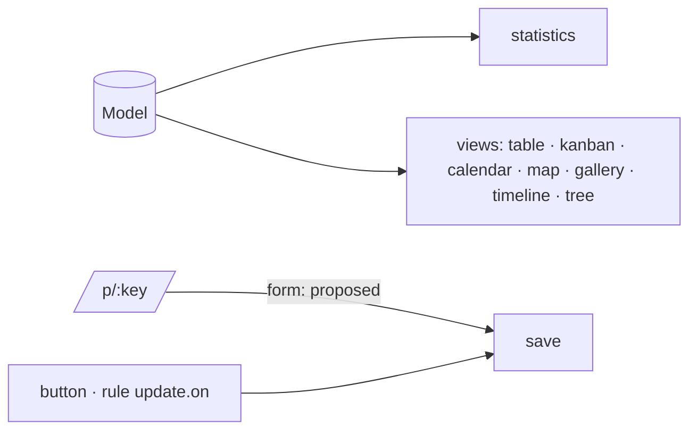
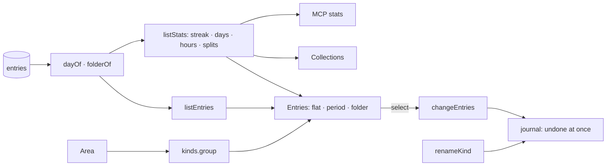

# Architecture

Jarvis OS is one core and three thin doors. The model thinks; the system remembers, keeps time and
gives the method (constitution II).

```mermaid
flowchart TB
  C[Claude / ChatGPT] -->|MCP · OAuth| MCP
  A[Jarvis app] -->|REST · session| API
  subgraph apps/api — Hono
    MCP[/mcp/]
    API[/api/]
    AUTH[/auth — accounts, OAuth/]
  end
  W[apps/worker — the watcher]
  MCP --> CORE
  API --> CORE
  W --> CORE
  CORE[packages/core — entries · links · journal · files · query]
  CORE --> DB[(Neon Postgres — RLS)]
  CORE --> S3[(Neon Object Storage)]
```

## The data

Everything in a life is an **entry**: an expense, a passport, a night of sleep, a person, a
routine, a reminder. Its kind is free text the model chooses (`Dépense`, `Passeport`, `Routine`),
its fields are free JSON. There is no table per kind and no migration for a new kind.



- **Spaces and members**: a space is a circle of people (decision 0005). Each account has its own
  space, private for good; a shared one (« Nous » for a couple) is joined only by an invitation the
  invited address accepts. A link never crosses spaces: themes are kinds and links, not spaces.
  Each space may hold a charter (an entry « Charte »): its rules, given to every client. A client
  (Claude, ChatGPT) reaches only the spaces she allowed it at consent (`client_space`). Identity
  tables (accounts, sessions, OAuth clients) are global by nature and reached only by the
  application.
- **Row-level security**: every table above carries `space_id` and its policy. The application
  connects as `jarvis_app` (`NOBYPASSRLS`); each request sets the acting person, and the policies
  let her reach only the spaces she is a member of.
- **The journal** keeps every change with its `before` and `after`: `undo` writes the `before`
  back and journals that too.
- **Query**: the model computes from the database, read-only, over temporary copies of her own
  rows (`my_entries`, `my_links`, `my_files`), with a time and a row limit — never on the real
  tables, the accounts or the journal (decision 0004).
- **Her data, hers** (decision 0007): a space leaves as a folder of Markdown (one file per entry,
  its kind and fields in the front matter, its links under « Liens », her files beside) and a
  Markdown folder enters the same way, origin « read », its path kept in `source`. An import is
  journaled as one `import.run`, undone at once; importing a folder again adds nothing twice.



- **Documents** (spec 008): any entry whose Markdown is in `texte`, written and read section by
  section; each change journaled, so each version can be taken back.
- **The watcher** (spec 006): a pass each minute finds the reminders due through one function that
  returns ids and members only, tells each person through her « Canal » (Telegram), and writes what
  it did as a member, under row-level security.
- **Type models** (specs 012, 014): a kind's shape is an entry « Model » (fields and their type,
  required, options, relations, formulas, lines, workflow, path, display). The core's `save` makes
  every door follow it; the export places entries by its path.
- **The app engine** (spec 014, decision 0008): an app is entries of system kinds — `Model`,
  `Page`, `Rule`, `Script` — that Claude writes with her and the core checks. Engine keywords are
  English; her kinds and fields stay in her words. See « The app engine » below.
- **The calendar** (spec 011): time is a field, not a kind. Any entry with `start` (and `end` or
  `duration`), `at`, `due`, `date` or `repeat` is in her calendar; `agenda` places its
  occurrences in a window, computed, never stored. Claude (`agenda`), the app (« Agenda »), the
  anticipation (`upcoming`) and her phone (a private iCalendar address) read the same function.



## The app engine



- **Relations** are `link` fields (`target`, `cardinality`, `inverse`): given as ids in `data`,
  stored as links whose role is the field's name; the other side reads them by their inverse.
- **Formulas** (`formula.ts`) are a small language parsed and evaluated by the core, never `eval`:
  arithmetic, comparisons, `sum avg count min max … where`, dates, `streak`. Computed when read
  (`computedOf`, `withComputed`), never stored; the doors return them as `computed`.
- **Pages** (`pages.ts`) declare filters and blocks (`stat`, `stat_delta`, `gauge`, `bar`, `line`,
  `breakdown`, `heatmap`, `table`, `task_list`, `kanban`, `calendar`, `form`, `record`). The core
  computes them; one view draws them inside Claude (`ui://jarvis/page`) and framed in the app.
- **Rules** (`rules.ts`) run inside the save that triggers them (three deep at most, never on their
  own change), and on a schedule or some days before a date through the watcher
  (`jarvis_due_rules`, migration 0007).
- **Scripts** (`scripts.ts`) are pure: `run(input)` returns changes, checked against what the
  script declared it writes, then saved. The core defines the port (`ScriptRunner`); the API gives
  QuickJS (WebAssembly): no network, no files, a deadline and a memory limit.
- **Migrations** (`migrations.ts`) rename, set or remove a field across a kind, journaled as one
  `migration.run` undone at once. **Bundles** (`bundles.ts`) export and install an app; Finances
  and Routines ship with Jarvis (`apps/api/src/apps/*.json`).
- **Trials** (`trial.ts`): a rule, a script, a migration or an install runs in a savepoint, its
  journal is read and rolled back — what she sees before saying yes.

## Views, her settings, her keys (spec 015)

- **Views** (`views.ts`): the entries of a kind as she explores them — filters on any field and one
  link away (each filter is a formula), sorts, columns, groups and totals, as a table, a kanban (a
  choice field; dragging a card is a save, through the workflow) or a calendar (a date field). A
  view she keeps is an entry « View », a tab of its app; Claude reads the same with `view`.
- **Areas**: a model's `area` (« Personnel », « Professionnel ») groups her apps in the sidebar.
- **Her zone** is in her « Channel » (`zoneOf`, `setZone`): every clock of the core reads it.
- **Telegram from the app**: a code whose fingerprint waits in her « Channel »; the watcher reads
  the bot and finds whose code it is (`jarvis_channel_by_code`, migration 0009).
- **Personal keys** (`personal_key`, migration 0010): for an app of hers (the real-time app of
  decision 0009); her policy only, the fingerprint only; the API takes `Bearer jos_…` as her.
- **Technical names are English**; what she reads comes from `label` and `optionLabels` (`fr`,
  `en`) and the catalogs. A refusal carries a `code` the app says in her language.

## Collections and the types of every day (spec 016)

- **Types**: besides text, numbers, amounts, dates, choices, links, formulas and lines, a field may
  be `url`, `email`, `phone`, `multi_choice`, `file`, `location`, `rating`, `progress`, `button`,
  `time`, `long_text`; and carry `default`, `min`, `max`, `unique` — all checked in `save`.
- **Formulas** gain `distance(a, b)` (km as the crow flies — no routing service) and
  `convert(amount, from, to)` (XOF, XAF, EUR fixed; other rates from her « Rate » entries).
- **Collections** (`collections.ts`): every kind with a model opens on its own, its statistics read
  from its model (splits of its choices, weeks, sums and averages).
- **Views** gain map (Leaflet over OpenStreetMap in the app), gallery, timeline and tree; a page
  may hold a view; a line compares several series.
- **Actions**: a `button` runs its action through `press`; a rule's `update.on` changes the entry
  it links to (an order takes from a product's stock).
- **Shares** (`shares.ts`, migration 0011): a public form (what it brings is « read » and
  « proposed ») or a public view, at `/p/:key`; only the key's fingerprint is kept.
- **Viewers** (migration 0011): reading needs membership; writing needs a member who is not a
  viewer — in the policies themselves.



## Entries she can find, file and count (spec 017)

- **Her day and folder** (`lists.ts`): an entry's day is its own (`date`, `at`, `start`, `due`),
  else a day, an ISO week (« W33 ») or a month read in its source path or title, else the day it
  was made. Its folder is `folder` (a field every kind may carry), else its source's folder.
- **Lists**: `listEntries` filters any entries by kind, words, period and folder and sorts them by
  day, title or change; the Entries page shows them flat, by period (year › month) or by folder (a
  tree), with its own scroll areas and a selection.
- **Statistics of any list** (`listStats`), with or without a model: this month, twelve weeks day
  by day, the current and best streak, the active days, the hours, the repeated values, the
  averages. Collections use them too; Claude reads them through `stats`.
- **Her groups of kinds**: an « Area » entry names the kinds it groups (`areas.ts`); else a model's
  `area`, else its app; Jarvis's own kinds apart. `kinds` gives each its `group`.
- **At once**: `changeEntries` (filed, retyped, set aside, linked) and `renameKind` are one journal
  line (`entries.change`, `kind.rename`) over their entries' lines, undone at once. On the page,
  entries are dragged onto a folder and kinds onto a group.
- **Habits** (`habits.ts`): a habit says its days (`days`: mon…sun, or her words in `jours` /
  `cadence` — « 7/7 », « lun-ven », « mar,mer,sam ») and `since`; the entries linked to it are the
  days she did it. The statistics give its rate (planned days against done, thirty days and since
  the start) and the days missed. Words not understood give no rate: nothing is guessed.
- **Her preferences of display** (`prefs.ts`): kinds flat or grouped, how each list opens — kept
  in her « Channel », so every device shows them alike.



## The doors

| Door    | For                                                             | Authentication                       |
| ------- | --------------------------------------------------------------- | ------------------------------------ |
| `/api`  | the Jarvis app, the portal, tests                               | a Better Auth session                |
| `/mcp`  | Claude, ChatGPT and any MCP client                              | an OAuth access token for one person |
| `/auth` | creating an account, signing in, consenting to a client         | Better Auth                          |
| `/app`  | her web account (spec 009): her life, spaces, connections, data | her session                          |
| links   | `/upload/:token`, `/document/:token`, `/invitation#…`           | a token signed by the server         |
| feed    | `/agenda/:key.ics`, her calendar for her phone                  | a key of hers, kept as its sha-256   |
| watcher | her reminders, on Telegram                                      | acts as each member                  |

The REST API and the MCP tools call the same core functions: what one does, the other does. Her
web account at `/app` (specs 009, 013) opens on « Maintenant » — what needs her, from `attention` —
lists her apps from her models and her files; it is one page that reads and acts through `/api` with her session; its
dashboards and documents are the clients' views, framed. A client she disconnects there is refused
by `/mcp` at once.

`/auth` is also the OAuth server of the `/mcp` resource: an MCP client discovers it from the 401,
registers itself, sends the person to sign in and consent, and gets a token for her alone. Each
`/mcp` request builds a server for that person with Jarvis's instructions, the tools and her
routines. The flow and the tools: [`apps/api/README.md`](../apps/api/README.md#mcp).

Some tools carry a view (MCP Apps, decision 0006): a dashboard, an entry as a card, a drop zone for
files. The host frames the view, which speaks to it over `postMessage` and calls the server's tools
through it; files go straight to `/upload/:token`, never through the model.

## Environments

| Neon branch | Used by            |
| ----------- | ------------------ |
| `main`      | production         |
| `dev`       | local development  |
| `test`      | local tests and CI |

Each branch has its own database and its own `files` bucket; `pnpm provision` makes them and
writes `.env`.
