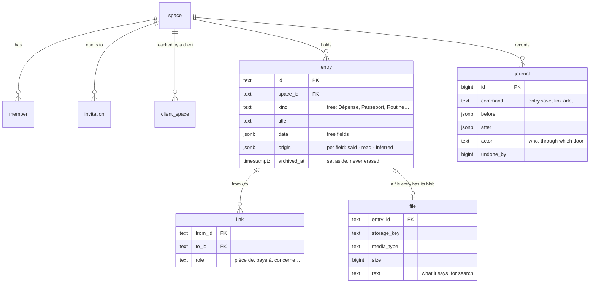
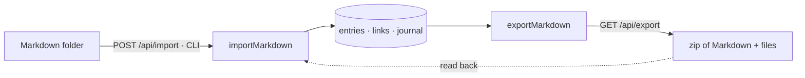

# Architecture

Jarvis OS is one core and three thin doors. The model thinks; the system remembers, keeps time and
gives the method (constitution II).

```mermaid
flowchart TB
  C[Claude / ChatGPT] -->|MCP · OAuth| MCP
  A[Jarvis app] -->|REST · session| API
  subgraph apps/api — Hono
    MCP[/mcp/]
    API[/api/]
    AUTH[/auth — accounts, OAuth/]
  end
  W[apps/worker — the watcher]
  MCP --> CORE
  API --> CORE
  W --> CORE
  CORE[packages/core — entries · links · journal · files · query]
  CORE --> DB[(Neon Postgres — RLS)]
  CORE --> S3[(Neon Object Storage)]
```

## The data

Everything in a life is an **entry**: an expense, a passport, a night of sleep, a person, a
routine, a reminder. Its kind is free text the model chooses (`Dépense`, `Passeport`, `Routine`),
its fields are free JSON. There is no table per kind and no migration for a new kind.



- **Spaces and members**: a space is a circle of people (decision 0005). Each account has its own
  space, private for good; a shared one (« Nous » for a couple) is joined only by an invitation the
  invited address accepts. A link never crosses spaces: themes are kinds and links, not spaces.
  Each space may hold a charter (an entry « Charte »): its rules, given to every client. A client
  (Claude, ChatGPT) reaches only the spaces she allowed it at consent (`client_space`). Identity
  tables (accounts, sessions, OAuth clients) are global by nature and reached only by the
  application.
- **Row-level security**: every table above carries `space_id` and its policy. The application
  connects as `jarvis_app` (`NOBYPASSRLS`); each request sets the acting person, and the policies
  let her reach only the spaces she is a member of.
- **The journal** keeps every change with its `before` and `after`: `undo` writes the `before`
  back and journals that too.
- **Query**: the model computes from the database, read-only, over temporary copies of her own
  rows (`my_entries`, `my_links`, `my_files`), with a time and a row limit — never on the real
  tables, the accounts or the journal (decision 0004).
- **Her data, hers** (decision 0007): a space leaves as a folder of Markdown (one file per entry,
  its kind and fields in the front matter, its links under « Liens », her files beside) and a
  Markdown folder enters the same way, origin « read », its path kept in `source`. An import is
  journaled as one `import.run`, undone at once; importing a folder again adds nothing twice.



- **Documents** (spec 008): any entry whose Markdown is in `texte`, written and read section by
  section; each change journaled, so each version can be taken back.
- **The watcher** (spec 006): a pass each minute finds the reminders due through one function that
  returns ids and members only, tells each person through her « Canal » (Telegram), and writes what
  it did as a member, under row-level security.

## The doors

| Door    | For                                                     | Authentication                       |
| ------- | ------------------------------------------------------- | ------------------------------------ |
| `/api`  | the Jarvis app, the portal, tests                       | a Better Auth session                |
| `/mcp`  | Claude, ChatGPT and any MCP client                      | an OAuth access token for one person |
| `/auth` | creating an account, signing in, consenting to a client | Better Auth                          |
| links   | `/upload/:token`, `/document/:token`, `/invitation#…`   | a token signed by the server         |
| watcher | her reminders, on Telegram                              | acts as each member                  |

The REST API and the MCP tools call the same core functions: what one does, the other does.

`/auth` is also the OAuth server of the `/mcp` resource: an MCP client discovers it from the 401,
registers itself, sends the person to sign in and consent, and gets a token for her alone. Each
`/mcp` request builds a server for that person with Jarvis's instructions, the tools and her
routines. The flow and the tools: [`apps/api/README.md`](../apps/api/README.md#mcp).

Some tools carry a view (MCP Apps, decision 0006): a dashboard, an entry as a card, a drop zone for
files. The host frames the view, which speaks to it over `postMessage` and calls the server's tools
through it; files go straight to `/upload/:token`, never through the model.

## Environments

| Neon branch | Used by            |
| ----------- | ------------------ |
| `main`      | production         |
| `dev`       | local development  |
| `test`      | local tests and CI |

Each branch has its own database and its own `files` bucket; `pnpm provision` makes them and
writes `.env`.
