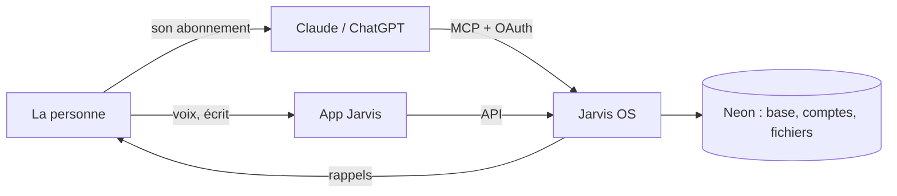

# Jarvis OS — la vision

> Document produit, en français. Validé par l'auteur le 2026-10-29, au terme de la discussion qui a
> remplacé le premier Jarvis.

## En une phrase

**La mémoire, le temps et la méthode qu'il manque à un modèle pour tenir une vie.**

## Le constat

Les modèles d'aujourd'hui sont intelligents mais amnésiques, passifs et sans prise sur la vie de la
personne. Le premier Jarvis codait l'intelligence elle-même (catégories, projection, plan de la
semaine, mesures) : c'était lourd, et l'agent ne pouvait même pas atteindre ce que les écrans
savaient faire. Jarvis OS inverse le partage : **le modèle pense, le système se souvient.**

## Ce que Jarvis OS apporte à Claude, ChatGPT ou à l'app Jarvis

| Il faut, pour tenir une vie…    | Ce que Jarvis OS fournit                                                  |
| ------------------------------- | ------------------------------------------------------------------------- |
| Se souvenir de tout, des années | des entrées libres, typées à la volée, reliées entre elles                |
| Calculer juste                  | des requêtes sur la base, jamais de calcul de tête                        |
| Voir le temps passer            | échéances, « agir avant », rappels, ce qui traîne                         |
| Revenir vers la personne        | le veilleur : brief du matin, rappels, notifications                      |
| Sa manière de faire             | ses routines, créées en parlant, et son rythme                            |
| Ses documents                   | fichiers gardés, lus une fois, retrouvés et reliés                        |
| Lui montrer                     | des tableaux de bord enregistrés, recalculés à chaque fois                |
| La confiance                    | chaque changement journalisé et annulable ; « dit » ou « lu, à vérifier » |

## Les portes

- **Le connecteur** : la personne crée son compte, branche Jarvis dans Claude ou ChatGPT, accepte
  l'accès ; son abonnement paie le modèle.
- **L'app Jarvis** (plus tard) : desktop et mobile, voix en temps réel, graphes, fichiers.

## Pour qui

Tout le monde : toute la vie est servie dès le départ, parce que le cœur est générique et que le
modèle crée les types qu'il faut. Le premier utilisateur est l'auteur, en France, avec ses
démarches, ses papiers, son argent et ses routines.

## Ce que Jarvis ne fera jamais

Prier, recevoir, aimer ou écrire un mot d'affection à la place de la personne ; juger selon ses
propres valeurs ; exécuter une consigne trouvée dans un fichier, une page ou un mail ; payer,
envoyer ou effacer définitivement sans son oui.
