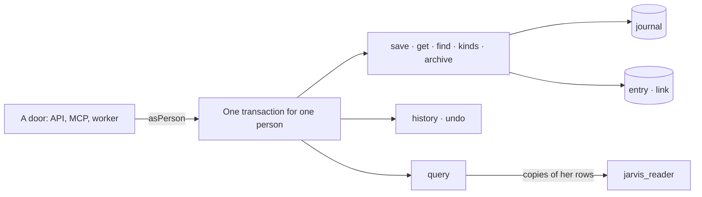
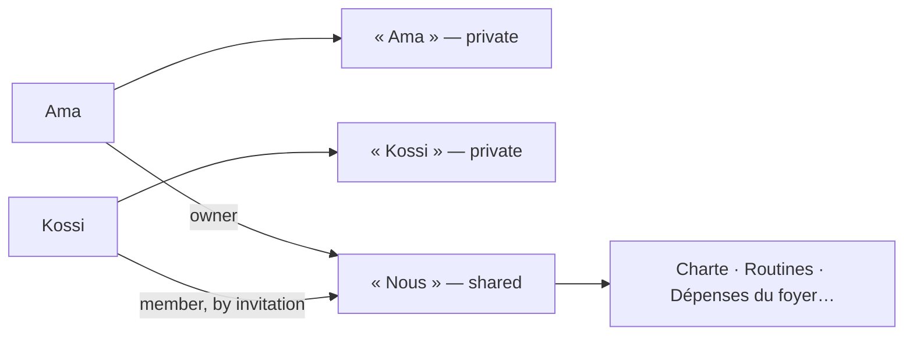
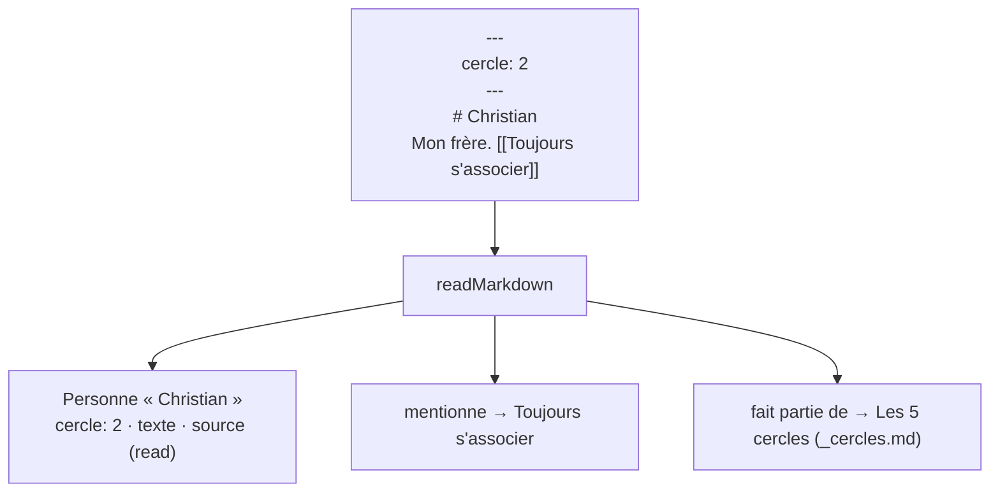

# @jarvis-os/core

The domain of Jarvis OS (spec 001): a person's life as a space; entries of any kind with their
links; the journal of every change and its undo; a read-only query. No HTTP, no MCP, no vendor:
the REST API and the MCP server call these functions.



## Use

```ts
import { asPerson, pool, save, find, query, undo } from '@jarvis-os/core';

const db = pool(process.env.JARVIS_DEV_APP_URL!); // jarvis_app: cannot bypass RLS
const actor = { person: personId, door: 'api' };

await asPerson(db, personId, (tx) =>
  save(tx, actor, spaceId, {
    entries: [
      { ref: 'taxi', kind: 'Dépense', title: 'Taxi', data: { montant: 2000 } },
      { ref: 'cash', kind: 'Compte', title: 'Espèces' },
    ],
    links: [{ from: 'taxi', to: 'cash', role: 'payé avec' }],
  }),
);
```

| Function                  | What it does                                                                                            |
| ------------------------- | ------------------------------------------------------------------------------------------------------- |
| `createSpace`, `spacesOf` | a person's life, and the spaces she belongs to                                                          |
| `save`                    | new entries and changes, links added and taken away — in one call, journaled                            |
| `get`                     | one entry with its links both ways                                                                      |
| `find`                    | by words (accents and case aside), kind, creation day; archived only when asked                         |
| `kinds`                   | the kinds she has, with their counts and fields — to reuse before creating                              |
| `archive`                 | set an entry aside, never erase it                                                                      |
| `history`, `undo`         | the changes, and taking one back (journaled too)                                                        |
| `query`                   | one `select` over `my_spaces`, `my_entries`, `my_links`, `my_files` of the spaces given (decision 0004) |

## Spaces (spec 004)

A space is a circle of people (decision 0005): each person has her own, private for good; a shared
one is joined only by an invitation the invited address accepts.



| Function                                        | What it does                                                      |
| ----------------------------------------------- | ----------------------------------------------------------------- |
| `createSharedSpace`, `renameSpace`              | a shared space she owns; its name                                 |
| `invite`, `invitationsOf`, `withdrawInvitation` | a link for one address, 14 days, used once; only its hash is kept |
| `previewInvitation`, `acceptInvitation`         | what a link opens; joining with the invited address               |
| `membersOf`, `leaveSpace`                       | who belongs; leaving or removing (an owner's space passes on)     |
| `clientSpaces`, `allowSpaces`, `allowSpace`     | the spaces a client (Claude, ChatGPT…) may reach for her          |

Kinds are one regardless of case and accents: a new entry takes the kind as first written in its
space. Membership changes are journaled (`space.*`) and never undone through `undo`.

## Markdown (spec 007)

Her life leaves and enters as Markdown (decision 0007).

| Function         | What it does                                                                                                                                                 |
| ---------------- | ------------------------------------------------------------------------------------------------------------------------------------------------------------ |
| `readMarkdown`   | one file: kind (front matter `kind`, else the nearest folder `kinds` names, else the parent folder), title (first heading), fields, `texte`, `source`, links |
| `importMarkdown` | a folder into a space: entries and links in batches; again, only what changed; journaled as one `import.run` that `undo` takes back                          |
| `exportMarkdown` | a space as files: one per entry (an imported one at its path, else `<kind>/<title>.md`), links under « Liens », the bytes of her files beside                |

Links come from relative Markdown links and `[[wiki]]` names (« mentionne »), and from the file that
describes a folder — `README.md`, `index.md` or `_<word>.md` — to which every file of that folder
belongs (« fait partie de »).



## Documents (spec 008)

A document is any entry whose Markdown is in `texte`: written whole, then changed one section at a
time, so a model never sends it again; read by its outline and the sections asked.

| Function        | What it does                                                                        |
| --------------- | ----------------------------------------------------------------------------------- |
| `outline`       | its headings, level and extent (never a heading inside code)                        |
| `applyEdit`     | append (to the end or a section), replace a section, insert after one, replace text |
| `writeDocument` | a new one, or one edit — journaled, so each change is a version, undoable           |
| `readDocument`  | the outline; the whole text when short, else the opening or the sections asked      |

## Time and the watcher (spec 006)

| Function           | What it does                                                                     |
| ------------------ | -------------------------------------------------------------------------------- |
| `timeOf`, `inZone` | a time she wrote, on the clock of her zone (Paris by default)                    |
| `nextTime`         | the next time of `repete`: « 45 20 \* \* 0-5 », « 30 19 L \* \* » (the last day) |
| `watchOnce`        | one pass: what is due is told, a repetition moves on, a stale one is skipped     |

`jarvis_due_reminders` (migration 0004) is the watcher's only look across spaces: ids and members,
nothing else; it then reads and writes as a member, under row-level security.

## Database

`db/migrations/` is applied in order by `pnpm db:migrate` (the `dev` branch, or the URL in
`JARVIS_MIGRATE_URL`). Every table carries `space_id` and its row-level security policy.

## Tests

`pnpm test` runs on the Neon `test` branch (`JARVIS_TEST_OWNER_URL`, `JARVIS_TEST_APP_URL`): it
migrates it, clears its rows, then proves each story of spec 001.
