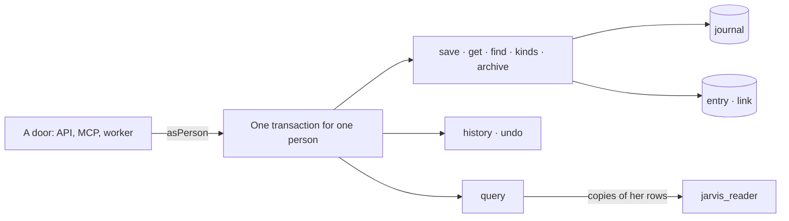

# @jarvis-os/core

The domain of Jarvis OS (spec 001): a person's life as a space; entries of any kind with their
links; the journal of every change and its undo; a read-only query. No HTTP, no MCP, no vendor:
the REST API and the MCP server call these functions.



## Use

```ts
import { asPerson, pool, save, find, query, undo } from '@jarvis-os/core';

const db = pool(process.env.JARVIS_DEV_APP_URL!); // jarvis_app: cannot bypass RLS
const actor = { person: personId, door: 'api' };

await asPerson(db, personId, (tx) =>
  save(tx, actor, spaceId, {
    entries: [
      { ref: 'taxi', kind: 'Dépense', title: 'Taxi', data: { montant: 2000 } },
      { ref: 'cash', kind: 'Compte', title: 'Espèces' },
    ],
    links: [{ from: 'taxi', to: 'cash', role: 'payé avec' }],
  }),
);
```

| Function                  | What it does                                                                    |
| ------------------------- | ------------------------------------------------------------------------------- |
| `createSpace`, `spacesOf` | a person's life, and the spaces she belongs to                                  |
| `save`                    | new entries and changes, links added and taken away — in one call, journaled    |
| `get`                     | one entry with its links both ways                                              |
| `find`                    | by words (accents and case aside), kind, creation day; archived only when asked |
| `kinds`                   | the kinds she has, with their counts and fields — to reuse before creating      |
| `archive`                 | set an entry aside, never erase it                                              |
| `history`, `undo`         | the changes, and taking one back (journaled too)                                |
| `query`                   | one `select` over `my_entries`, `my_links`, `my_files` (decision 0004)          |

## Database

`db/migrations/` is applied in order by `pnpm db:migrate` (the `dev` branch, or the URL in
`JARVIS_MIGRATE_URL`). Every table carries `space_id` and its row-level security policy.

## Tests

`pnpm test` runs on the Neon `test` branch (`JARVIS_TEST_OWNER_URL`, `JARVIS_TEST_APP_URL`): it
migrates it, clears its rows, then proves each story of spec 001.
