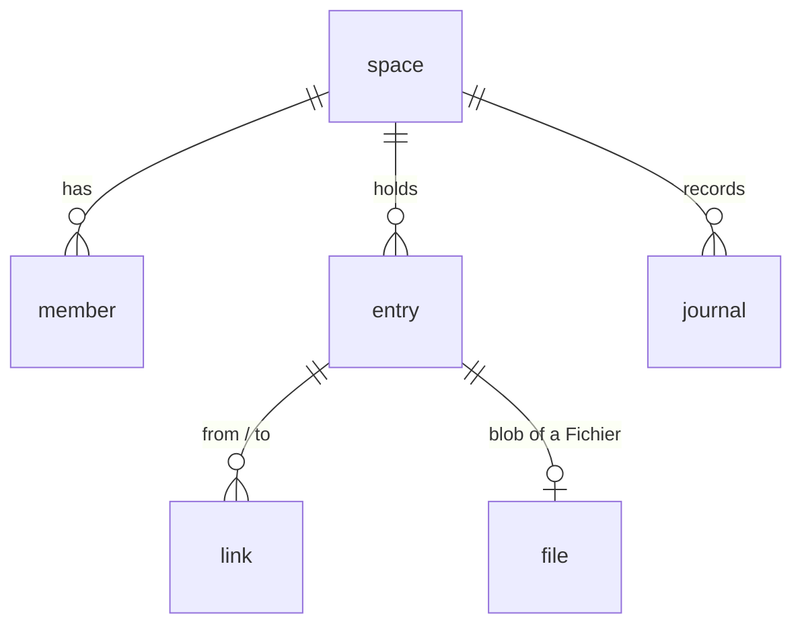

# Data model — 001 core

| Table     | Columns                                                                                                                                | Notes                                                                                                 |
| --------- | -------------------------------------------------------------------------------------------------------------------------------------- | ----------------------------------------------------------------------------------------------------- |
| `space`   | `id` text pk · `name` · `created_by` · `created_at`                                                                                    | a person's life                                                                                       |
| `member`  | `space_id` · `person_id` · `role` (`owner`) · pk (space, person)                                                                       | who may act                                                                                           |
| `entry`   | `id` text pk · `space_id` · `kind` · `title` · `data` jsonb · `origin` jsonb · `created_at` · `updated_at` · `archived_at`             | `kind` free text; `origin` maps a field to `said` / `read` / `inferred`                               |
| `link`    | `id` text pk · `space_id` · `from_id` · `to_id` · `role` · `created_at` · unique (from, to, role)                                      | both entries in the same space                                                                        |
| `journal` | `id` bigint pk · `space_id` · `at` · `command` · `target` · `before` jsonb · `after` jsonb · `actor` · `door` · `client` · `undone_by` | `command`: `entry.create`, `entry.update`, `entry.archive`, `link.add`, `link.remove`, `journal.undo` |
| `file`    | `entry_id` pk · `space_id` · `storage_key` · `name` · `media_type` · `size` · `text`                                                   | filled in spec 002                                                                                    |

## Roles and security

- `neondb_owner` owns the tables and runs migrations.
- `jarvis_app` (`LOGIN NOBYPASSRLS`, made by `pnpm provision`) is what the doors connect as; each
  transaction sets `jarvis.person` to the acting person.
- `jarvis_reader` (`NOLOGIN NOBYPASSRLS`, granted to `jarvis_app`) is what `query` runs as: it is
  granted only the temporary copies of her rows (`my_entries`, `my_links`, `my_files`) made for
  that query, never a real table (decision 0004).
- Every policy: the row's space is one the acting person is a member of
  (`jarvis_is_member(space_id)`, security definer over `member`).
