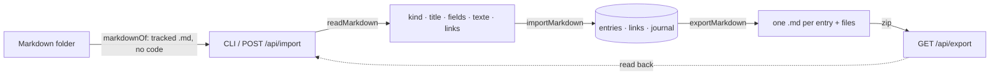

# Implementation Plan: Her data, hers — Markdown out and in

**Branch**: `007-markdown` | **Date**: 2026-10-29 | **Spec**: [spec.md](spec.md)

## Summary

The format lives in the core (`packages/core/src/markdown.ts`): YAML front matter for the kind and
fields, the first heading for the title, the rest for `texte`, Markdown links for links. The import
writes in batches (a few queries per 200 entries) and is journaled as one `import.run` line that
lists its changes; `undo` walks them back. The API zips the export by hand (stored files, CRC from
`node:zlib`); a command line reads a folder (git-tracked files, code projects left out) for the
author.

## Constitution Check

| Principle                    | How this plan keeps it                                                        |
| ---------------------------- | ----------------------------------------------------------------------------- |
| I. Simple and working        | one module, one YAML parser; the zip is 50 lines; no migration                |
| II. The model thinks         | kinds and links come from her folder; the model reads `texte` and follows     |
| III. One core, several doors | the format is the core's; REST and the command line call it                   |
| IV. Her life is hers alone   | the import runs as her, under row-level security; the export is hers to carry |
| V. Trust                     | origin « read », the source path kept, every change journaled, undone at once |

## Complexity Tracking

None.
