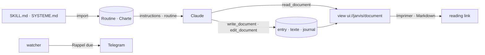

# Implementation Plan: Her method and her documents

**Branch**: `008-method` | **Date**: 2026-10-29 | **Spec**: [spec.md](spec.md)

## Summary

Nothing new to store: a skill is a « Routine », a rule file a « Charte », a document any entry with
Markdown in `texte`. The import learns to name kinds by path and to read hidden folders asked for;
the core learns sections (`outline`, `applyEdit`); the MCP server gets three tools and one view; a
signed link serves the document to print or download. The watcher (spec 006) ships beside it.

## Constitution Check

| Principle                    | How this plan keeps it                                                   |
| ---------------------------- | ------------------------------------------------------------------------ |
| I. Simple and working        | no table, no library: Markdown rendered in 140 lines, repetitions in 120 |
| II. The model thinks         | her skills are text the model follows; it writes documents, Jarvis keeps |
| III. One core, several doors | sections and time in the core; MCP, REST and the watcher call it         |
| IV. Her life is hers alone   | the watcher sees ids and members only, then acts as each person          |
| V. Trust                     | every version journaled and undoable; her text escaped in every view     |

## Complexity Tracking

None.
