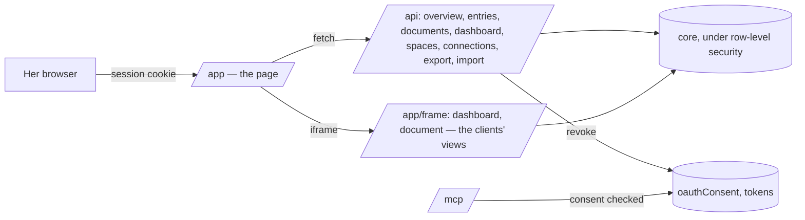

# Implementation Plan: The platform — her web account

**Branch**: `009-platform` | **Date**: 2026-10-29 | **Spec**: [spec.md](spec.md)

## Summary

A fourth door beside the REST API, MCP and the watcher: one HTML page served at `/app` behind her
Better Auth session, its script drawing each page from `/api`. Dashboards and documents are not
redrawn: the app frames the very views Claude shows, given their data by the server
(`/app/frame/…`). Four API routes fill the gaps; `/mcp` learns to refuse a revoked client.

## Constitution Check

| Principle                    | How this plan keeps it                                                         |
| ---------------------------- | ------------------------------------------------------------------------------ |
| I. Simple and working        | one page, no framework, no build; the views reused, not rewritten              |
| II. The model thinks         | the app reads and settles; thinking stays with the model she chooses           |
| III. One core, several doors | the app calls `/api` like the Jarvis app will; nothing of its own is stored    |
| IV. Her life is hers alone   | her session, row-level security; she chooses what each client reaches, revokes |
| V. Trust                     | every change shown with its origin and undoable; her data downloadable         |

## Complexity Tracking

None.
