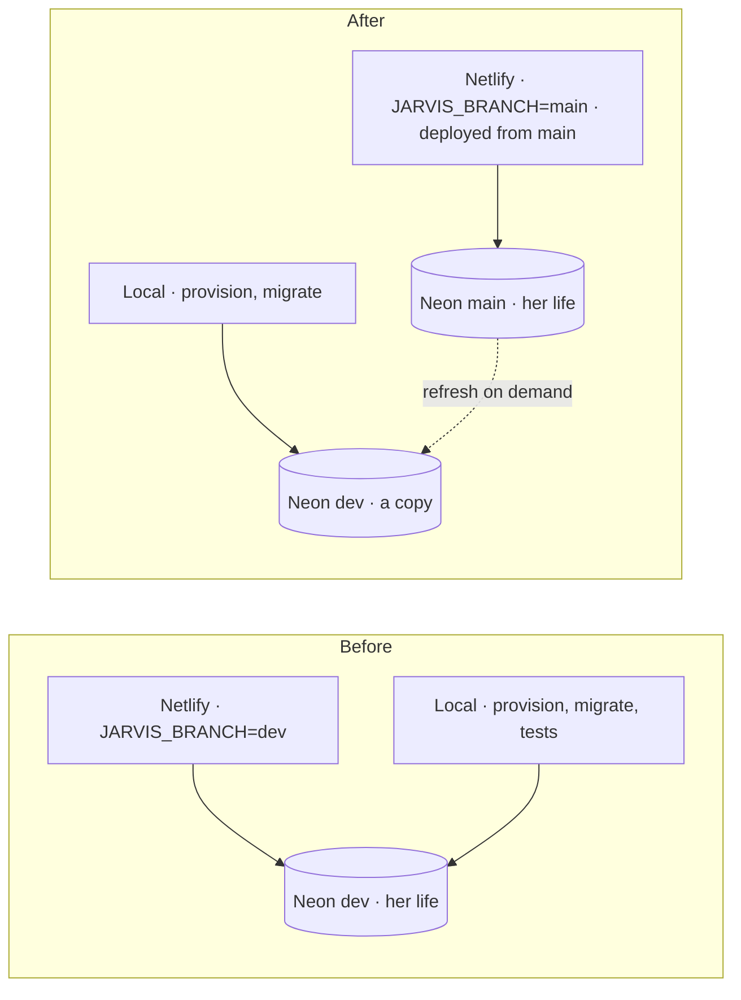

# Implementation Plan: Production, apart and from the repository

**Branch**: `010-production` | **Date**: 2026-11-09 | **Spec**: [spec.md](spec.md)

## Summary

Put in the repository what Netlify runs (the `api` function, the `watcher` function each minute),
deploy it from one command, then move her life from the Neon branch `dev` to `main` and switch
production to `main`. `dev` becomes a development copy.

## Technical Context

- Netlify Functions v2 (`.mts`, ESM): `api` with `config.path = "/*"` hands every request to the
  Hono app (`makeApp(settingsFor(branch, JARVIS_PUBLIC_URL)).app.fetch`); `watcher` with
  `config.schedule = "* * * * *"` runs one pass (`watcherPass`) and returns.
- The CLI (`netlify-cli`, pinned, run through `npx`: its postinstall needs a flat `node_modules`)
  bundles the functions with esbuild;
  QuickJS stays external so its WebAssembly file ships beside the bundle.
- Neon API: `POST /projects/{id}/branches/{main}/restore` with `source_branch_id = dev` and
  `preserve_under_name`; S3 copy of the `files` bucket between the two branches' storages.

## Constitution Check

| Principle                    | How this plan keeps it                                                                              |
| ---------------------------- | --------------------------------------------------------------------------------------------------- |
| I. Simple and working        | Same host, same code; three files and one script.                                                   |
| III. One core, several doors | Netlify functions are thin adapters over `makeApp` and `watcherPass`.                               |
| IV. Her life is hers         | Production keeps the role that cannot bypass RLS; no production owner credential stays on a laptop. |
| V. Trust                     | The restore keeps a backup; nothing switches before the counts match; every step needs `--apply`.   |
| VII. Proof                   | Draft deploy checked before any switch; counts printed before and after.                            |

## Order of the switch

1. Draft deploy from the branch (still `JARVIS_BRANCH=dev`): `/health`, `/connexion`, OAuth metadata.
2. At a quiet moment, with the author's yes: `tooling/production.ts --apply` (restore, migrate, copy
   files, counts).
3. Netlify variables `JARVIS_BRANCH=main` and `JARVIS_MAIN_*` (app URL, auth secret, storage).
4. Production deploy from `main` after the pull request is merged.
5. Check: site, counts, a reminder; keep `dev`'s variables for one week, then remove them.
