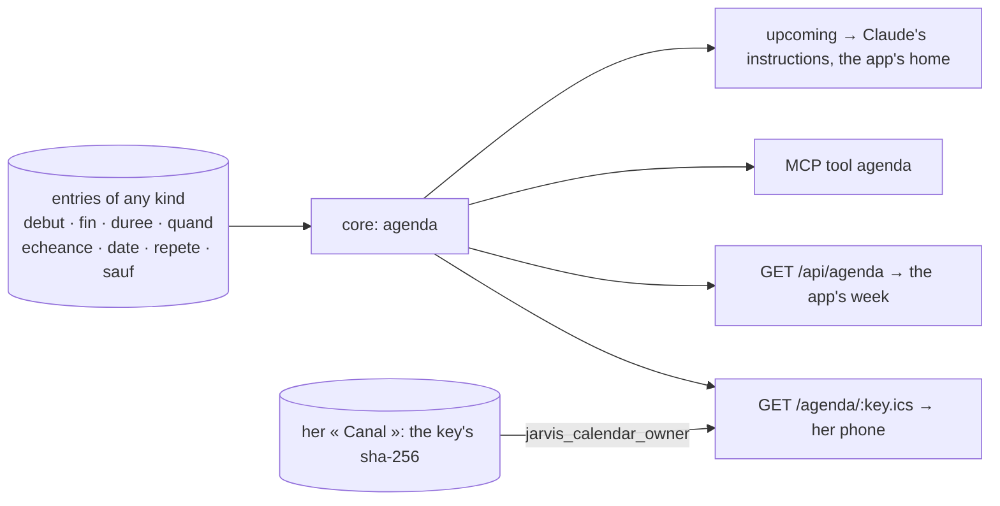

# Implementation Plan: The calendar — one model of time

**Branch**: `011-calendar` | **Date**: 2026-10-30 | **Spec**: [spec.md](spec.md)

## Summary

No table, no special kind. One core function, `agenda`, reads every entry that carries a time
field and places its occurrences in a window — repetitions expanded, days off skipped, cancelled
ones left out. `upcoming` (spec 006) becomes the calendar of the next days. Four doors read it:
the MCP tool `agenda`, `GET /api/agenda`, the app's « Agenda », and a private iCalendar address
for her phone — where a repetition goes once, as an RRULE, so her phone repeats it itself.

## Decisions

- **Time is a field.** Any entry with `debut` (and `fin` or `duree`), `quand`, `echeance`, `date`
  or `repete` is in her calendar. Claude keeps the kind she uses (« Événement », « Session »,
  « Culte »); nothing is migrated (constitution II).
- **A day alone is the whole day** in the calendar (a reminder's `quand` alone still means 09:00 for
  the watcher). A past `date` is history — her journal — not her calendar.
- **Bounded**: a window of at most 366 days, at most 200 occurrences per entry.
- **The phone's address** is a random key; only its sha-256 is kept, in her « Canal » entry of her
  own space. One security-definer function finds whose it is, nothing else; the feed is then read
  as her, under row-level security. A new address stops the old one.
- **Repetitions in the feed**: one event with an RRULE when the five fields say one time a day on
  every day, some weekdays, some days of the month or one day a year (`sauf` as EXDATE, `jusqu` as
  UNTIL); otherwise the occurrences one by one.

## Constitution Check

| Principle                    | How this plan keeps it                                               |
| ---------------------------- | -------------------------------------------------------------------- |
| I. Simple and working        | one function over existing entries; no table, no sync, no new kind   |
| II. The model thinks         | Claude places things in time with fields; the calendar only reads    |
| III. One core, several doors | `agenda` in the core; MCP, REST, app and iCal are thin readers       |
| IV. Her life is hers alone   | the feed reads as her, under RLS; the key is hers, hashed, renewable |
| V. Trust                     | answers come from `agenda`, never from memory; proposals are marked  |

## Complexity Tracking

None.
