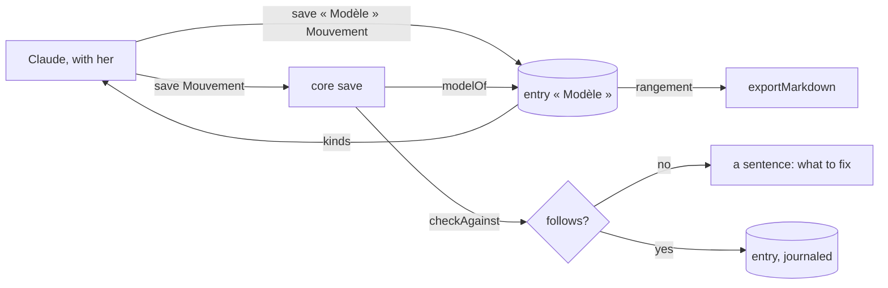

# Implementation Plan: Type models

**Branch**: `012-models` | **Date**: 2026-10-30 | **Spec**: [spec.md](spec.md)

## Summary

`packages/core/src/models.ts` reads a kind's « Modèle » and checks a save against it; `save` calls
it for every entry; `kinds` returns the models; `exportMarkdown` places entries by `rangement`.
Claude learns models from the routine « Les modèles » and rule 1.

## The layers of an app (decision)

An app (Finances, Routines) is data Claude writes with her — never code:

1. **Models** (this spec): fields, natures, required, choices, rangement, display.
2. **Relations and computations** (next): links declared with their cardinality and inverse;
   computed fields across them (a balance, a remaining budget, a streak) compiled by the core.
3. **Pages** (with spec 013): blocks declared — table with totals, board, calendar, chart, form —
   drawn by one renderer in the app and in Claude.
4. **Rules**: « when / if / then », run by the watcher, journaled, proposing rather than acting.

Each layer ships when a real app needs it; Finances, from the author's Life OS, comes first.

## Constitution Check

| Principle                    | How this plan keeps it                                        |
| ---------------------------- | ------------------------------------------------------------- |
| I. Simple and working        | one module, one check in `save`; no table                     |
| II. The model thinks         | Claude designs models with her; the system holds and enforces |
| III. One core, several doors | the check is in `save`: MCP and REST meet the same; an import keeps her files as they were |
| V. Trust                     | refusals say why; a model is an entry, journaled and undoable |

## Complexity Tracking

None.
