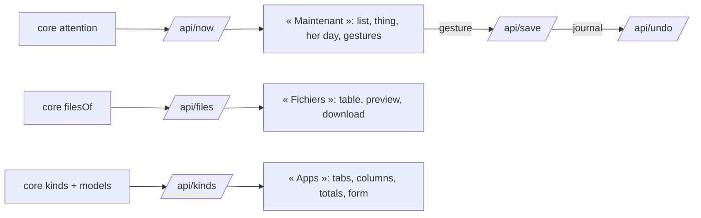

# Implementation Plan: The platform, organised around her day

**Branch**: `013-platform` | **Date**: 2026-10-30 | **Spec**: [spec.md](spec.md)

## Summary

Two core functions and two routes feed a new shell of the same one-page app (spec 009):
`attention` (what needs her, read from statuses and the calendar of spec 011) and `filesOf` (her
files with their links). The apps come from the models of spec 012: `/api/kinds` already gives
them. The design is the mockup validated with the author, `docs/design/jarvis.html`.

## Decisions

- **No new state.** « Maintenant » is computed: `statut` « à corriger » / « non envoyé » (fix),
  passed moments and deadlines not done (late), `statut` « proposé » (proposed), the calendar of
  today and the next seven days. Repeated blocks stay in her day, not in the list.
- **Gestures are saves**: done (`statut` « fait »), cancel or decline (« annulé »), accept or plan
  again (« à venir »), tomorrow (`quand`, `echeance`, `debut`, `fin` a day later). The notice
  undoes the last one through the journal.
- **Apps are models**: the menu lists the `app` of her models; a page per app, a tab per kind, the
  model's `colonnes`, `total`, `regroupement`; the form is drawn from its fields. Relations,
  computations and declared pages come with the next layers (spec 012's plan).
- **Files**: one listing query with the links either way; `?download=1` serves an attachment.

## Constitution Check

| Principle                    | How this plan keeps it                                                   |
| ---------------------------- | ------------------------------------------------------------------------ |
| I. Simple and working        | two functions, two routes, the same one-page app; no build, no framework |
| II. The model thinks         | the app settles and reads; proposals come from Claude, as entries        |
| III. One core, several doors | `attention` and `filesOf` in the core; the app only calls `/api`         |
| V. Trust                     | every gesture journaled and undoable; origins shown on every field       |

## Complexity Tracking

None.
