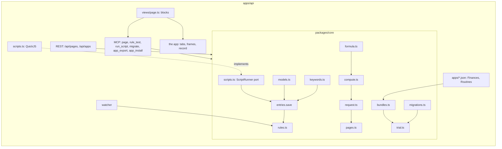

# Implementation Plan: The app engine

**Branch**: `014-engine` | **Date**: 2026-10-30 | **Spec**: [spec.md](spec.md) | **Decision**:
[0008](../../docs/decisions/0008-the-app-engine.md)

## Summary

Apps become data Claude writes and the core checks: models with relations, formulas, lines and
workflows; pages of declared blocks fed by declarative queries; rules run inside `save` and by the
watcher; scripts run in QuickJS behind a port; migrations and bundles. Every write goes through
`save`; every rule, script, migration and install can be tried in a savepoint first. Engine
keywords become English, with migration 0006 and a transition that renames old names on save.

## Order

1. Keywords in English (models, time, states), migration 0006, the transition in `save`.
2. Relations (link fields → links), formulas, lines, workflows; `computed` returned by the doors.
3. Declarative queries, pages and blocks; the page view in Claude and in the app; record pages.
4. Rules (on save, schedule, before), `rule_test`, migration 0007 for the watcher.
5. Scripts (port + QuickJS), migrations of a kind, bundles; Finances and Routines shipped.

## Constitution Check

| Principle                    | How this plan keeps it                                                                        |
| ---------------------------- | --------------------------------------------------------------------------------------------- |
| I. Simple and working        | each layer is a module of the core; Finances proves each; no new table                        |
| II. The model thinks         | apps are entries Claude writes; behaviour is data and routines, not code paths per app        |
| III. One core, several doors | queries, pages, rules run in the core; the script engine is a port, QuickJS an adapter        |
| IV. Her life is hers         | no new table; rules and scripts act as a member, under RLS; definer functions return ids only |
| V. Trust                     | every write through `save`, journaled; trials before; figures from formulas, never stored     |

## Complexity Tracking

| Addition         | Why it is needed                                        | Simpler alternative rejected because                         |
| ---------------- | ------------------------------------------------------- | ------------------------------------------------------------ |
| A formula parser | balances, budgets, streaks computed the same everywhere | SQL in each widget breaks when a field is renamed            |
| QuickJS          | scripts must not reach the host, the network or others  | Node's `vm` is not a security boundary                       |
| Trials           | she must see what a rule, script or migration will do   | describing it in words is a guess; the savepoint is the fact |
