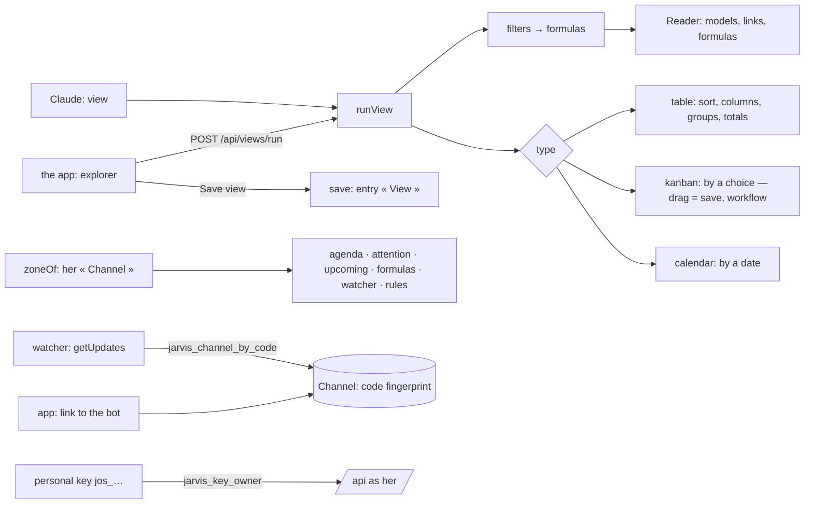

# Implementation Plan: A system to use every day, and to share

**Branch**: `015-finish` | **Date**: 2026-10-30 | **Spec**: [spec.md](spec.md) | **Decision**:
[0009](../../docs/decisions/0009-realtime-keys.md)

## Summary

Views (`views.ts`): a view is `{ kind, type, filters, sort, columns, groupBy, by, date }`; each
filter becomes a formula, so a filter through a link is the formula engine of spec 014. Areas are a
model's `area`. Her zone lives in her « Channel » and every clock of the core reads it (`zoneOf`).
Telegram is linked by a code whose fingerprint waits in her « Channel » (migration 0009). Personal
keys are a table of her own (migration 0010). Refusals carry a `code`.

## Constitution Check

| Principle                    | How this plan keeps it                                                                   |
| ---------------------------- | ---------------------------------------------------------------------------------------- |
| I. Simple and working        | views reuse formulas and the reader; no new engine                                       |
| III. One core, several doors | `runView` serves the app and Claude; Telegram stays in the API                           |
| IV. Her life is hers         | keys: her policy only, fingerprint only; definer functions return an id and nothing else |
| V. Trust                     | a dragged card is a save, checked by the workflow, undoable                              |

## Complexity Tracking

| Addition             | Why it is needed                                 | Simpler alternative rejected because               |
| -------------------- | ------------------------------------------------ | -------------------------------------------------- |
| `personal_key` table | an app of hers reaches the API without a browser | a session token expires and is not revocable alone |
