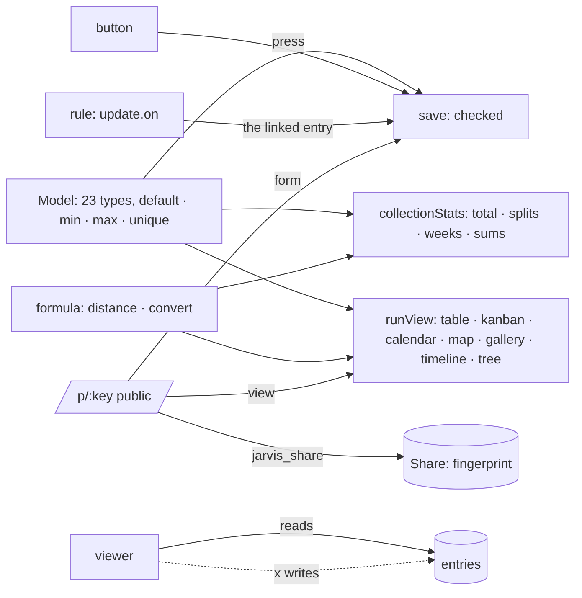

# Implementation Plan: Collections and the types of every day

**Branch**: `016-collections` | **Date**: 2026-10-30 | **Spec**: [spec.md](spec.md)

## Summary

The model gains eleven types and field options, checked in `save`. Formulas gain `distance` and
`convert` (rates from « Rate » entries, beside the fixed pegs). Collections (`collections.ts`)
compute their statistics from the model. Views gain map, gallery, timeline and tree; pages gain a
`view` block and multi-series lines. A `button` is pressed through `press`; a rule's `update` may
reach a linked entry. Shares (`shares.ts`, migration 0011) open a public form or view; members may
be viewers (migration 0011: writing policies separated from reading).

## Constitution Check

| Principle             | How this plan keeps it                                                                    |
| --------------------- | ----------------------------------------------------------------------------------------- |
| I. Simple and working | statistics read from the model, no configuration; no routing service                      |
| IV. Her life is hers  | a share opens only what she chose; viewers are kept out by the policies themselves        |
| V. Trust              | what a form brings is « read » and « proposed »; a button and a rule write through `save` |

## Complexity Tracking

| Addition                  | Why it is needed                        | Simpler alternative rejected because           |
| ------------------------- | --------------------------------------- | ---------------------------------------------- |
| Leaflet (from a CDN)      | a real map of her places, OpenStreetMap | a drawn map says nothing of streets            |
| Separate writing policies | viewers                                 | checking the role in each door could be missed |
