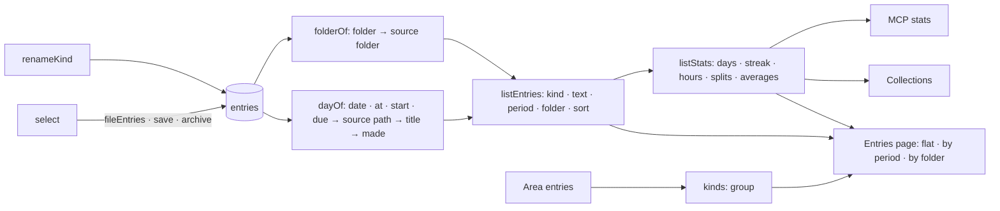

# Implementation Plan: Entries she can find, file and count

**Branch**: `017-entries` | **Date**: 2026-10-31 | **Spec**: [spec.md](spec.md)

## Summary

`lists.ts` reads, for any entries: their day (`dayOf`), their folder (`folderOf`), a list
filtered and sorted (`listEntries`), and its statistics (`listStats`, which collections now use
too). `folder` becomes a field every kind may carry. A kind is grouped by an « Area » entry, its
model's `area`, its app, or as Jarvis's own (`kinds` says `group`). `renameKind` and `fileEntries`
change many entries under one journal line (`kind.rename`, `entries.file`), undone at once.

## Constitution Check

| Principle             | How this plan keeps it                                              |
| --------------------- | ------------------------------------------------------------------- |
| I. Simple and working | read from what her entries already hold; no table, no configuration |
| V. Trust              | renaming and filing many entries are journaled and undone at once   |
