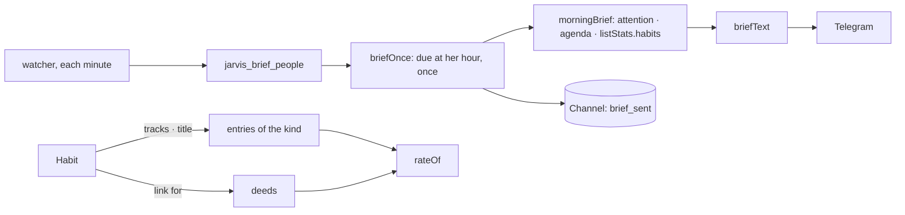

# Implementation Plan: Every day, without lifting a finger

**Branch**: `018-every-day` | **Date**: 2026-10-31 | **Spec**: [spec.md](spec.md)

## Summary

`habitsOf` (in `lists.ts`) finds a list's habits — the list itself, the habits its entries are
done `for`, or those tracking its kind — and counts for each its `for` links and the entries of
its tracked kind. `brief.ts` composes her day from `attention` and `listStats`, and `briefOnce`
sends it once a day through a teller the API gives (Telegram). `dayOf` reads any field holding a
day; `attention` leaves noted moments out of « late ». The web account's script is cut into
`platform/client/*`, joined in `page.ts` in the order it runs.

## Constitution Check

| Principle             | How this plan keeps it                                                   |
| --------------------- | ------------------------------------------------------------------------ |
| I. Simple and working | no table; the brief reads what she keeps; a habit counts without links   |
| V. Trust              | once a day, never at night; a mention is not a deed; nothing is guessed  |
| Data isolation        | the watcher gets only people's ids, then acts as each under row security |
