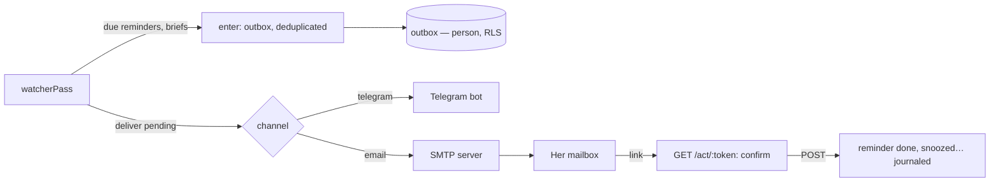

# Implementation Plan: Every message, on her channel, and its trace

**Branch**: `020-outbox` | **Date**: 2026-11-09 | **Spec**: [spec.md](spec.md)

## Summary

The watcher no longer calls Telegram: it enters messages in an outbox, then delivers the outbox
through her channels (Telegram, e-mail by SMTP), with three tries and a trace. A reminder's e-mail
carries signed one-use action links.

## Technical Context

- Migration `0013_outbox.sql`: table `outbox` (`person_id`, `space_id`, policy on `person_id`),
  functions `jarvis_outbox_pending(now)` and `jarvis_outbox_person(id)` (security definer).
- `nodemailer` 10.1.7 (pinned) in `apps/api`, SMTP only; tests use its JSON transport.
- Action tokens: `base64url(payload).base64url(hmac-sha256)`, payload `{ o: outbox id, a: action,
x: expiry }`; the outbox row says whether it was used.

## Constitution Check

| Principle      | How this plan keeps it                                                                    |
| -------------- | ----------------------------------------------------------------------------------------- |
| I. Simple      | One table, two channels, retries with three fixed delays; no queue service.               |
| III. One core  | The core stores and decides; channels live in `apps/api`.                                 |
| IV. Hers alone | `outbox` carries `person_id` and its policy in the same migration.                        |
| V. Trust       | Actions from a link are journaled (door « email »); a GET never acts; nothing sent twice. |
| VII. Proof     | Each story ends with its proof.                                                           |
