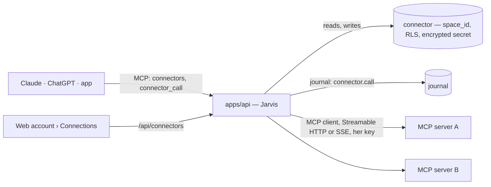

# Implementation Plan: Her tools, through Jarvis

**Branch**: `025-connectors` | **Date**: 2026-11-09 | **Spec**: [spec.md](spec.md)

## Summary

Jarvis becomes an MCP client as well as a server. A person connects any MCP server reached over HTTP
to one of her spaces; Jarvis keeps its key encrypted, reads its tools and resources, and gives every
door (Claude, ChatGPT, the app) access to them through two tools, `connectors` and `connector_call`.
P1 ships keys and headers; P2 adds resources and OAuth.



## Technical Context

- **Language**: TypeScript strict, Node 22 · **Framework**: Hono · **MCP**: the official SDK
  (`@modelcontextprotocol/sdk`, already a dependency) for its client and transports.
- **Storage**: one new table `connector` (migration `0019_connectors.sql`), with `space_id` and its
  policy `jarvis_is_member(space_id)`.
- **Secrets**: AES-256-GCM in `apps/api/src/secrets.ts`, key from `JARVIS_<BRANCH>_SECRETS_KEY`
  (32 bytes, base64). Absent key: connectors are disabled with a readable refusal, nothing else
  breaks (Netlify keeps working until the variable is set).
- **Tests**: Vitest on the Neon `test` branch; a test MCP server started in-process over HTTP.

## Constitution Check

| Principle                    | How this plan keeps it                                                                                                                                                            |
| ---------------------------- | --------------------------------------------------------------------------------------------------------------------------------------------------------------------------------- |
| I. Simple and working        | Two MCP tools instead of one per remote tool; keys first, OAuth after; no background sync yet.                                                                                    |
| II. The model thinks         | Jarvis forwards and remembers; choosing which tool to call stays with the model.                                                                                                  |
| III. One core, several doors | `packages/core/src/connectors.ts` stores and journals, without HTTP, MCP or crypto; the MCP client and the cipher live in `apps/api`.                                             |
| IV. Her life is hers         | `connector` carries `space_id` and its RLS policy in the same migration; a client reaches only the connectors of the spaces she allowed it.                                       |
| V. Trust is built in         | Every create, change, cut and call is journaled (no secret, no arguments, no result); answers are framed as outside content; destructive or open-world tools need `agreed: true`. |
| VI. Never in her place       | Jarvis never calls a tool on its own in this feature.                                                                                                                             |
| VII. Proof                   | Each user story ends with its proof (spec).                                                                                                                                       |

## Project Structure

```
packages/core/db/migrations/0019_connectors.sql   table, RLS, grants
packages/core/src/connectors.ts                   create, list, get, update state, cut — journaled
packages/core/src/journal.ts                      commands connector.add · connector.change · connector.cut · connector.call
apps/api/src/secrets.ts                           seal / open (AES-256-GCM)
apps/api/src/connectors.ts                        the MCP client: probe, list tools, call, list and read resources
apps/api/src/routes.ts                            /api/connectors…
apps/api/src/mcp.ts                               tools `connectors`, `connector_call`
apps/api/src/platform/…                           Connections › « Jarvis uses »
apps/api/tests/connectors.test.ts                 proofs of US1, US2 (and US3)
.env.example, tooling/provision.ts                JARVIS_<BRANCH>_SECRETS_KEY
docs/ARCHITECTURE.md                              the connectors, with their diagram
```

## Design notes

- **Probe** (`connect`, then `listTools`, then `close`) on create, on check and when the page opens;
  the result (state, server name, tools with their annotations and input schemas, resources) is
  stored on the connector, so `connectors` answers without calling the server.
- **Call**: a fresh client per call (stateless, like the MCP door), timeout 30 s, answer truncated
  to 50 000 characters and wrapped as `{ from: "<connector>", content: … }`.
- **Agreement**: a tool with `destructiveHint: true` or `openWorldHint: true` (or no annotations at
  all with a name that writes: `create`, `delete`, `send`, `update`, `pay`…) requires `agreed`.
- **Transport**: Streamable HTTP first; on a 4xx answer to the first request, SSE.
