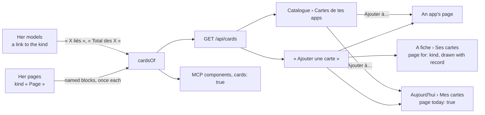

# 107 — Les cartes: dashboards made on the page itself, at every scale

_21 Nov 2026. After the study of a reference CRM (dashboards of named cards, « Add card » on the
page, the same cards on a record). The author validated the plan the same day._

## Step back (the standing rule)

What it is in the v3 model: **not a new module**. A card is a **block of the registry, already set
and named** — a page is already a list of blocks (spec 014), drawn by one renderer (D21). What the
v3 lacks is not an engine but three gestures and one scale:

1. **Named cards.** Today a block is generic: she answers questions to set it. Yet her apps' pages
   already hold blocks set and named (« Dépenses du mois », « À payer »). Those are the cards.
2. **Changing the page on the page.** Today « Modifier la page » leaves for the Composer. The page
   itself should open « Ajouter une carte », show what is « Sur la page », move, widen, remove.
3. **The fiche as a scale.** An entry's fiche has no cards. A page attached to a kind, computed for
   one entry (`{record}`, already understood by every formula), gives it some.
4. **Aujourd'hui** stays a moment, not a dashboard (never mix natures): it gains only a band of
   cards of her own, made the same way.

What already exists and stays: an app's menu (Aperçu, its pages, its data, its activity) is
already its tabs; the Composer stays, as « Un bloc à moi » for what no card covers.

## What changes

### 1. A card (core)

- `cardsOf(space, { app?, kind? })`: every block **with a title** on her pages, each once (the
  same settings twice are one card), with its app, the page it comes from and its family:
  - **Chiffres**: stat, stat_delta, gauge;
  - **Graphiques**: bar, line, breakdown, heatmap, funnel, sql;
  - **Listes**: table, datatable, task_list, kanban, review, calendar, view, record, highlights;
  - **Saisie**: form.
- For a fiche (`kind`): the cards **derived from her models** — for every kind that points to this
  one by a relation field: « Ses <kind> » (a table of those that point to this entry), and when
  that kind has an amount, « Total <kind> ». Nothing is written per domain: an app that relates its
  kinds gets fiche cards.
- A block may say its **size**: `s`, `m` or `l` (a third, half or the whole width). Without it, a
  wide block (table, kanban, calendar…) is `l`, the others `m`. The figures stay in their band.
- A page may be **Aujourd'hui's band** (`today: true`, one per space) or **a kind's fiche**
  (`for: <kind>`, one per kind), drawn with `record` = the entry shown.

### 2. Changing on the page (client)

- Every page (an app's page, Aujourd'hui's band, a fiche) has « Modifier ». In that mode:
  - each card has: move up, move down, its size (S, M, L), remove;
  - « Ajouter une carte » opens a panel: a search, the families (Toutes, Chiffres, Graphiques,
    Listes, Saisie), each card with its app and its sentence, « Sur la page » when it is there, « + »
    otherwise; at the end, « Un bloc à moi » (the Composer);
  - « Enregistrer » keeps the page; « Annuler » leaves it as it was.
- On the phone: one column, the same buttons (no dragging).

### 3. The scales

- **An app**: its menu stays its tabs; « + Nouvelle page » at the end of its pages.
- **Aujourd'hui**: « Mes cartes », a band under the figures; empty, it offers « Ajouter une carte ».
- **A fiche**: « Ses cartes » under its fields, the kind's page drawn for this entry; the first card
  added makes the kind's page.

### 4. The catalogue of components

- A section « Cartes de tes apps » above the blocks: each card computed on her data, with
  « Ajouter à… » (her pages, Aujourd'hui).
- One source: the panel and the catalogue read the same `GET /api/cards`.

### 5. Through the assistant

- The MCP tool that lists components also lists her cards; Claude adds one to a page by saving the
  page, as it already does.

### 6. Her dashboards (added 24 Nov 2026)

The author asked where the dashboards are: they lived only inside an app. Now:

- **« Tableaux de bord »** in the menu, after the views across her life, always there. It lists
  **her** dashboards — pages of cards outside any app (no `app`, format `dashboard`) that mix all
  her apps — each with its number of cards; one gesture opens one, « Tous les tableaux » comes
  back. An app's own dashboards live in the app and are not listed twice (24 Nov 2026, the author
  agreed): a line at the end leads to each, and nothing here deletes them.
- **Supprimer**, on each one and on the one open, after a confirmation: archived — her data stays,
  the Activity gives it back in one gesture.
- **« Nouveau tableau de bord »**: its name, then « Modifier » at once; kept on « Enregistrer »
  once it holds a card — saved without one, it says so (« Ajoute au moins une carte ») instead of
  vanishing.
- **« Ma vue d'ensemble »**: one gesture — of each app, its first two figures and one chart or list
  (16 cards at most), then hers to change.
- **« Créer une carte »** at the top of « Ajouter une carte » (not on a fiche): the Composer's
  block made from plain answers (which kind, how to count, by what), named; once saved, it is one of
  her cards everywhere. It replaces the link « Un bloc à moi ».

### 7. A card set on screen (added 24 Nov 2026)

The author: « certaines données peuvent être configurées dans certains graphes quand j'aimerais —
valable pour tout composant ». A card placed was fixed (moved, widened, removed only).

- **Read back, set anew.** The core reads a card back as the Composer's plain answers
  (`answersOf`): its shape (the component), of what, how to count, by what, over which time, only
  which value, its columns, its days. She changes them; the core sets the card anew
  (`reshapeBlock`) by the Composer's own rules — the same for every component it composes. A card
  of the same component keeps what composing does not write (a kanban's gestures and links, a
  table's order while its column is there); its size stays, and its title in every language while
  she keeps its words. A part of its condition the screen cannot read is kept as it is, shown,
  and can be removed.
- **Two new answers**: « Sur » — this month, the last 3, 6 or 12 months (`this_month`,
  `last_days`) — and « Seulement » — one value of a choice field. A group by a link reads and
  writes as the title of the entry it points to (« fund.title »).
- **What is not set on screen** — a query of its own, a formula, a figure with its comparison, a
  card whose answers would not make it again: its name and size only; the rest is asked of the
  assistant. Offered only when the answers make the card again.
- **« Régler »** on each card in « Modifier »: the panel of its settings; « Appliquer » changes the
  card on the page, « Enregistrer » keeps the page.
- **On a chart, without « Modifier »**: its shape (barres, courbe, répartition — a curve needs a
  date) and its time, one gesture each, kept on the page at once. On an app's page, a dashboard,
  Aujourd'hui's band, a fiche.
- **A card set on a page is that page's**: the page it came from does not change.
- **Doors**: `POST /api/cards/answers` `{ block }` → `{ answers | null, settable }`;
  `POST /api/cards/reshape` `{ block, answers }` → `{ block }`, refused in words.

### 8. Her apps' dashboards, folded (added 24 Nov 2026)

« Dans tes apps » is one folded line (« 5 apps · 19 tableaux »): opened, one row per app — its
icon, its name, its dashboards as links. Closed by default; open or closed as she left it, on
this device.

## How it fits

A figure (`stat`, `stat_delta`) stands in the band of figures at the top of a page: in
« Modifier » it is moved or removed, never widened. Every other card has its size.

## Proof

- Core (Vitest): cards from pages, once each, with their family; fiche cards derived from a
  relation; a page `today` and a page `for` checked; sizes.
- API (Vitest): `GET /api/cards`, `GET /api/pages?today=1`, `GET /api/pages?for=<kind>`, a fiche page
  drawn for one entry.
- End to end (Playwright, three widths): on an app's page, « Modifier », add a card, widen it, move
  it, remove one, save, reload — the page is as left; Aujourd'hui's band from empty; a fiche's
  cards; the catalogue's « Ajouter à… ».

## Out of scope (next: spec 109)

Agents' questions, signals in Aujourd'hui with tabs by app, skills as buttons on a fiche.
