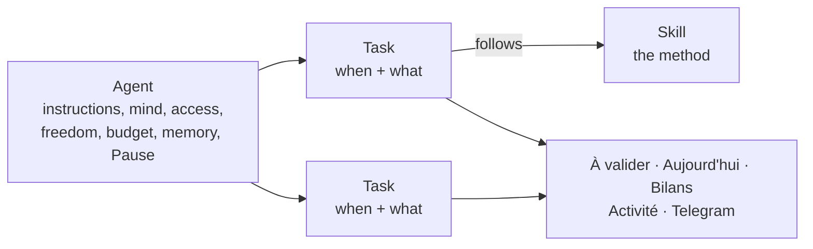

# 109 — Agents and their tasks: who, when, how — each in one place

_24 Nov 2026. The author stepped back on the agents screen (« plus fluide, plus clair ») and
validated this model the same day._

## Step back

What the screen mixed: an agent's cards listed rules and Jarvis's own works; a « when » lived on
rules **and** on skills (`triggers`); a phrase (« /bilan ») looked like the way to start a bilan;
the only thing made on screen was « chaque jour à heure fixe, rappelle-moi »; nothing could be
changed, tried or run from there.

The model, each word in one place:

|           | What it is                                                                            | Has a time? |
| --------- | ------------------------------------------------------------------------------------- | ----------- |
| **Agent** | who works: its instructions, its mind, its access, its freedom, budget, memory, Pause | no          |
| **Task**  | one mission of that agent: **when** + **what** (a reminder, a skill over a period)    | **yes**     |
| **Skill** | the method: preparation, instructions, criteria and style, result                     | no          |

An agent shares its frame with its tasks, not its method: each task chooses its skill (a weekly
bilan is not a monthly one); the skill's method wins over the agent's instructions. A phrase is a
shortcut, never the way. Nothing new runs: a task is kept as a rule (spec 006).

## What changes

1. **A plan set freely** (`core/tasks.ts`): every day, on weekdays, on some days (L M M J V S D),
   once a month (the 1st…28th, or its last day), every N hours; one time. Written as the five
   fields the watcher already reads (`scheduleOf`), read back (`planOfSchedule`), its next three
   times on her clock (`nextRuns`). Or an event: a kind saved, a message, a phrase.
2. **A task that follows a skill** (`skillActions`): until the agent has a mind of its own, Jarvis
   prepares the work on its time — a « Bilan » to write over the day, week, month or year when the
   skill makes one — and reminds her; her assistant writes it when she asks (the skill « Les
   bilans » finds what waits).
3. **« Essai à blanc »** (`tryRuleData`): a task, kept or not, run inside a transaction that is
   undone — what it would change, its next times; nothing written.
4. **« Lancer maintenant »** (`runRuleNow`): as on its time, under its agent (Pause, budget apply).
5. **Her text as task lines** (`tasksFromText`, no AI): each sentence that says a time (« chaque
   vendredi à 18 h », « le dernier jour du mois à 19 h », « en semaine à 9 h », « toutes les 2 heures »)
   becomes a task to confirm — the skill it names recognized; the rest stays her **instructions**,
   kept on the agent (`instructions`).
6. **The screens** (Construire):
   - « Tes agents »: one line each — its next work (« prochaine fois : ven. 18:00 · Bilan hebdo »),
     its tasks, its state, its Pause; « Nouvel agent ».
   - An agent's page, three tabs: **Tâches** (its tasks — switch, essai, lancer, modifier,
     retirer, confier — Jarvis's own works, « Nouvelle tâche »; « Ses consignes » with « Tirer les
     tâches »), **Fil** (its passes, its journal), **Réglages** (mind, access, freedom, report,
     memory, budget).
   - « Nouvelle tâche »: the sentence she completes, read back as she sets it (« Chaque vendredi à
     18 h, Bilans fait « Bilan hebdo » sur la semaine »), then « Essai à blanc », then « Créer ».
   - Skills: each says which task follows it; a phrase is its shortcut; a skill's old moment
     (`triggers` with a time) is moved to a task of an agent in one gesture, and leaves the skill.
   - « Chaque jour, à heure fixe » is gone: « Nouvelle tâche » does it and more.
7. **Doors**: `GET /api/tasks`; `POST /api/tasks/skill`, `/api/tasks/try`, `/api/tasks/:id/run`,
   `/api/tasks/from-text`; `POST /api/agents`; `PATCH /api/agents/:title` takes `instructions`;
   MCP `agent_set` too.

## Not yet (needs her decision)

- **A mind for the agent**: Claude (with a key — Jarvis's for everyone, or each person's) or a
  server of hers, so that a skill's task is written by the agent itself on its time.
- **Its questions** in its thread and in « À valider ».

## Proof

- Core: `tests/tasks.test.ts` — plans written and read back, next times (the last day of the month),
  eight French sentences, her text as lines and instructions, a skill's task, a dry run that writes
  nothing, a run that prepares the bilan over seven days.
- API: `tests/tasks.test.ts` — an agent made (a name taken refused), a skill's task tried, kept,
  listed with its agent and next times, run now; her text drawn.
- End to end: `apps/e2e/tests/agents.spec.ts`, three widths — an agent and its task set freely,
  tried, kept, run, stopped; her text as task lines, her instructions kept; a skill's moment moved
  to a task.
